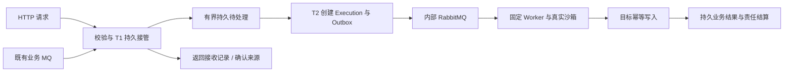

# Design

## Context

动机和范围见 [proposal.md](proposal.md)。基线为 `1158e413e55d92127d615d666c5d4e4bcc15514f`；B0 测量和针对性验证已完成，用户现已授权继续 B1–B5 的开发、验证及 OCR 审查；当前实施中，提交 PR 前通知用户。结果、瓶颈及计时边界见 [B0 报告](b0-results.md)。

已核对当前正式 `event-delivery`、`event-subscription-management` 规格，以及以下代码：

- `subscription_delivery.py`：T1/T2、订阅/全局配额事务锁、默认单订阅 10/s、全局 50/s；入口 limits 只能收紧代码默认值。
- `subscription_management.py`：启停、激活绑定、运行锁、pending/processing 维护和失败责任。
- `outbox.py`：有界发布、逐条确认、每轮固定 1 秒等待；`attempt.py`：每 Adapter 的 Slot 0。
- `worker/executor.py`、`worker/sandbox.py`：逐次准备/子进程执行及真实资源预检。每条业务都使用真实执行路径，增加入口速率并不自动摊薄它们。
- README 和现行事件文档：已有四种事件来源、适配器内操作及固定节点边界。部分历史架构段落仍描述早期三语言/触发类型；本单不把这些旧概述当作当前能力缺失。

## Goals / Non-Goals

**Goals:** 复用同一责任账本，在固定资源下测量并提升完整链路；让 HTTP 也能先保存再执行；分别证明接收、业务结果、资源与故障恢复。用户侧保持适配器、运行设置、执行/接收记录的原使用习惯。

**Non-Goals:** 不扩大为集群调度，不更换固定 Worker，不放宽同 Adapter 单 active Attempt，不改普通业务失败默认重试，不用额外 MQ/Redis 或常驻用户进程代替测量。业务批次是有条件的后续设计分支，未满足其合同前不实现。

## Decisions

### D1. 先完成 B0，再建设新入口和管理界面

B0 的唯一数值合同见 [b0-measurement-plan.md](b0-measurement-plan.md)。选择已有 RabbitMQ 来源、200 条独立消息，先获得真实 Worker/目标完整链路证据。相较于先造 HTTP 入口或只测 Adapter 函数，这能尽早区分接收锁、调度等待、发布连接、沙箱准备和目标写入开销。

不把默认限速或历史 175 ms 样本当作系统极限。B0 允许最小观测代码和夹具，不含吞吐优化；观测补丁与原基线分别登记。B0_PASS 后只意味着可继续实施，不代表正式容量通过。

### D2. HTTP 作为被动来源接入同一持久账本

选择注册一个 `http` 来源，仍绑定 Task/manual Adapter，与 Kafka/RabbitMQ 等共用 Subscription、ConfigVersion、Activation、Receipt/Delivery、Checkpoint、Quota 和权限。一个 Adapter 仍至多一条未删除订阅。原 Webhook Adapter 和 `/api/hooks/{public_id}` 的两种响应模式保持。

HTTP 不运行 SDK 拉取循环；其请求处理器使用现有 Runtime 管理的有效 owner/generation，经同一事务门禁接收。owner 未就绪、功能关闭、配置切换或生命周期冲突只拒绝新接收，不能记坏消息。HTTP 亦使用一个本地串行 shard，按实际 T1 接管序推进；不承诺网络到达顺序或跨重启的上游全局 FIFO。

HTTP 的停止是持久接管权限的逻辑关闭：在原 Adapter/订阅锁下先 fence，再同事务清除该被动租约并标为 stopped。进程退出后尚未到期的旧 HTTP 租约也适用，不等待一个不存在的 SDK 关闭回调。本地被动线程随后退出不能把状态写回 stopping；其启动回调遇停用而返回普通生命周期异常时，应归还该已结束的被动 owner 名额。HTTP 请求的原生工作、字节与请求名额由独立 IngressResources 持有，不能在逻辑停用时提前释放；已接管责任、历史及未完责任编辑锁保持。MQ 的实际连接关闭、关闭未知与预算归属规则不变。

不另造平行 Inbox 或借用旧 Webhook 的 `accepted` 改变返回含义。HTTP 配置包含不可复用的公开路由 ID、token Credential 引用及来源 epoch。路由 ID 固定映射到原订阅及 epoch，不转移或重新绑定；停用不释放历史路由映射。显式 reset 建立新 epoch 时也分配新路由，旧路由在留存窗口内只允许当前合法凭据查询或读回已存在记录，未命中原记录的 POST 返回 `410 ingress_epoch_retired`；删除后只保留不可复用标记，不继续开放外部查询。删除/重建使用新 ID 和 epoch，旧请求不能悄悄变成新责任。

### D3. HTTP 外部合同与身份

| 接口/行为 | 本稿选择 |
| --- | --- |
| 接收 | `POST /api/ingress/{public_id}`，Bearer token、`Idempotency-Key` 必填、单个 application/json 值 |
| 身份 | `(subscription_id, source_epoch, Idempotency-Key)`；key 为 1–128 字节可打印 ASCII，不使用内容哈希代替调用方 ID |
| 内容 | 以原始 UTF-8 正文 bytes 的 SHA-256 判相同内容；空格/序列化不同也属于不同正文，发送方必须保留原文重试；token、请求时间等不进入稳定哈希 |
| 首次成功 | T1 提交后 `202`，返回 receipt_id、received_at、processing_status 和相对 status_url；execution_id 在 T2 前可为空，不表示业务成功 |
| 同 ID 同内容 | 先在当前权限下识别已存在记录，返回同一 receipt_id 及当前状态，HTTP `200`；不增加接收/执行责任，不因额度已满或停用而丢失幂等读回 |
| 同 ID 不同内容 | `409 event_identity_conflict`；原内容/责任不覆盖；HTTP 返回明确拒绝，不把一个未接管冲突请求变成阻塞所有合法请求的永久来源屏障 |
| 查询 | `GET /api/ingress/{public_id}/receipts/{receipt_id}`，同一路由当前有效 token；只返回本来源的安全状态、错误码和执行关联，不返回原文、代码、凭据或其他订阅数据 |
| 管理查询/处置 | 继续走现有 Adapter view/edit 权限和接收记录；外部 token 不获得 replay、skip、reset 或管理权限 |
| 拒绝 | 认证/对象不可见按既有安全约定；不支持格式/压缩 `415`、正文/结构超限 `413`、不合法 JSON/ID `422`、容量 `429`、临时不可用 `503`；429/503 给 1–30 秒有界 Retry-After |
| 结果不明 | 连接断开/超时并不证明没提交；发送方保留原 ID/原文查询或重试，不能生成新 ID。数据库去重和待处理记录同事务提交 |

HTTP 新请求遇停用返回 `409 ingress_disabled`，不接管；平台接收开关关闭或 owner 暂未就绪返回 `503 ingress_unavailable`。已存在记录的同参读回和查询只依赖当前有效认证与持久数据，不依赖新接收开关、当前 Worker 在线或内部 Broker 可用。

原始正文以 Receipt 的可空来源原文字段保存，完整解析值放在 `dlr.event.v1.data.payload`。HTTP 扩展不重算旧来源身份/哈希，不修改旧事件 Envelope。原文字段、Envelope、必要历史副本及元数据均计入字节占用，不只计算 2 KiB 用户正文。JSON 无法无损进入现有存储合同（如不允许的值）时明确拒绝，不套用 Task 输入保存的自动清洗。

HTTP 去重元数据默认 30 天、原文 7 天，未完责任和恢复引用持续保护。客户端声明的重试期限不能超过公布的去重窗口；窗口外不承诺永久去重。来源 token 轮换后只接受当前有效凭据，历史查询不绕过撤权。

### D4. 接收绑定与生命周期

T1 在同一事务中保存完整可处理输入、身份、占用及不可变激活绑定。绑定包括 Revision、固定 Worker、Credential 引用、运行超时/资源和重试策略；T2/自动重试不能再查“当前最新配置”替换它。凭据真值仍在实际运行时依现行授权读取，不落快照。

沿用现行保守规则：启用或排空时禁止普通代码、Worker、凭据引用和来源配置修改；名称/描述与现有受限 repair 例外保持。未接管新请求在停用提交后拒绝，已接管责任继续排空。删除须先停用、确认原生/HTTP owner 已失效、旧责任结清。修复版本、当前配置 replay 和 Kubernetes completed 资格继续按原合同明确授权，不因提升容量放开。

这比允许在同一积压内随时切换配置更易审计；之后若要开放更灵活编辑，另立行为变更。新 HTTP 接口不为当前 Webhook 制造隐藏的输入或响应模式切换。

### D5. 正式容量配置与分层记账

容量选择“部署平台上限 + ConfigVersion 中的入口 limits”。部署管理员通过非敏感 `DLR_INGRESS_CAPACITY_PROFILE` 配置 global 与 subscription_max 的 JSON；缺省保持现有值。启动时验证正整数、条数/字节/速率关系、平台预算和持久空间，保存有效配置指纹及审计；不认识字段或无效配置拒绝启用新接收。配置变更重启后生效，前后指纹进入私有运维记录；首期不新增带积压的热调额 API。同一平台各接收进程必须使用同一持久生效指纹，不一致的进程停止新接管，不各按本地上限竞争；管理和旧责任排空仍可用。

入口 limits 仍通过 existing config version + Adapter edit 权限修改，须停用、关闭和排空，且每项不超过平台配置上限。提高平台上限需要部署权限；普通用户不能由入口 API 修改它。全局上限下调可能使旧责任超限：计数和原文保留，只拒绝新接管，继续旧责任结算。放弃完成确认不能顺便改额度，也不能成为绕过容量配置的入口。

T1 将原文/身份/责任/占用原子提交；T2 在同一事务内写入 Admission、Execution、Outbox、关联及退出 pending/扣减相应占用，提交后整次责任交接一并生效，不能拆为提交后的第二次释放。事务失败则整体回滚、保留原责任。原文、历史、去重、replay 和控制/诊断预留各自保留；终态释放及清理幂等。预留和实际占用均纳入上限，不能为了恢复临时免记账或提前删除旧失败。

完整输入副本分层计费：设完整 Envelope 的紧凑 UTF-8 JSON 为 `E` bytes，HTTP 原始正文为 `R` bytes（旧来源为 0），每 Receipt 的有界结构元数据预留 4,096 bytes、每 Delivery 预留 512 bytes。T1 的完整责任预算为 `2E + R + 4,608`：原始 Envelope/正文、未来 `Execution.input` 完整副本及两份结构元数据都已预付，T2 不会因历史刚好满额而无法交接。结构在写入前验证不超过预留，4 KiB 足以覆盖当前合法 UTF-8 shard/身份及后续时间/状态字段；预留不是 PostgreSQL 物理页、索引或 WAL 字节的精算。历史按 Receipt 原文一次和各 Delivery 的执行副本/元数据分别合计，replay 只新增执行副本与其 512 bytes 关联预留，不重复收取共享原文；pending 仍使用完整责任预算的保守上界。

7 天原文到期只释放实际清除的 Receipt Envelope/HTTP 正文，未创建或已不存在 Execution 的未用副本预留也可释放；真实 `Execution.input` 仍存在时保留其历史字节和条数。没有输入副本但仍有元数据时，历史条数可以为 0、字节仍非 0。30 天去重窗口到期且无未完/恢复引用时，清理路径先真正清除关联 Execution 输入副本，再释放剩余元数据和副本预算并删除责任记录；重复清理不重复扣减。外部删除 Execution 导致关联置空时不会先免账，由下一次合法清理确认后释放。旧数据升级按已保留原文、执行副本和元数据增加差额，同步全局/订阅账本，不重置旧计数、身份、哈希或输入。旧 JSONB 输入在迁移时按其保守序列化尺寸计费。

Kubernetes 控制 Envelope 仍限制为原 8,192 bytes。每项预付控制预算提升为 `2×8,192 + 4,096 + 512 = 20,992` bytes，最多三项；旧批次按剩余控制项数补足预留差额并同步原账本。完成责任放弃审计仍遵守原 8,192 bytes 内容边界，不借扩大预付额度放宽业务/审计内容。正式容量参数必须在运行前按上述完整计费及实际输入核对余量；原候选 64/128 MiB 不能因只计算用户正文就被当成可容纳一万条的证据，需要调整时先更新配置合同并单独冻结，不在运行中临时扩额。

正式一万条首轮的候选容量配置固定如下，只有 B1 实现公开配置机制后才可使用；B0 仍保持原默认值：

| 层 | pending 数量/字节 | history 数量/字节 | dedupe | 接管速率 |
| --- | --- | --- | --- | --- |
| 单入口 | 12,000 / 256 MiB | 30,000 / 256 MiB | 100,000 | 250/s |
| 全局 | 24,000 / 512 MiB | 60,000 / 512 MiB | 200,000 | 500/s |

2026-10-26 B3 前置计费读回：对 B1 真实 2,048 bytes 的 HTTP/RabbitMQ 各 20 条原始 Envelope，加入完整批次输入和每成员 8,192 bytes 控制/关联预留后，每条分别为 20,488 / 20,538 bytes；一万条保守投影约 195.4 / 195.9 MiB。旧 64/128 MiB 候选不足，因此在任何正式容量运行之前将 pending 字节合同改为上述 256/512 MiB，历史上限及 5/60/600 秒、平台/应用资源界限保持。每轮仍冻结真实 ID/Envelope 尺寸及配置指纹；此调整只增加磁盘持久责任额度，不扩大应用内存/在途名额，也不是运行中临时扩额。

这是待审查的基准参数，不是所有部署的推荐默认值或已验吞吐。正式验收前用真实计费尺寸核对余量；若需改合同，先修订设计并记录独立轮次，不在运行中扩大容量。

### D6. 入口与管理面资源隔离

HTTP 在读取正文前取得非阻塞有界名额，首期上限 32 个请求、正文总在途 8 MiB，包含未知 Content-Length 的预留；单正文 64 KiB、最终 Envelope 256 KiB、JSON 深度 32、总值/成员节点数 4,096，解析并发 8。只接受未压缩 UTF-8 JSON，压缩明确 415。读取总时间 5 秒、空闲时间 2 秒；无名额直接拒绝，不开无限等待队列。

已创建的正文子预算或来源父预算明确不足以容纳下一请求预留时，可在最外层 ASGI 对精确的新接收 POST 路径提前返回相同的 `429 ingress_capacity_exceeded` / `Retry-After: 1`，包括账户入口的对应路径。该检查只读既有用量，不初始化资源、不读正文或访问数据库，不预订或释放名额；其余请求仍走原认证及权威 acquire。每请求预留 320 KiB，因此 8 MiB 字节预算可先于 32 请求名额耗尽。取消不提前归还原生工作占用，状态查询与管理 API 不走此捷径。

接收与管理使用独立有限 DB pool/执行线程预算：接收最多 8 个 DB 连接、管理与现有恢复保留 4 个；额外后台连接须列入同一有限总额，不能无限 overflow。新入口处理器与普通管理 event loop 隔离到受限执行池；资源仍计入 1 GiB 应用总预算。解析及原生调用超时后，其工作未真正结束前不归还名额；必要时通过受限子进程终止回收，不累积失控线程。

MQ 延续实际 SDK/frame/prefetch 限额，所有来源应用在途字节合计 ≤64 MiB。HTTP 的 8 MiB 子预算包含在其中，不是额外 8 MiB。高水位停止接管，低水位仍采用计入预留后的 80% 及原最老待处理条件；正常等待不热重投、不反复建连。磁盘剩余 ≤5 GiB 停止新接管，恢复至 ≥6 GiB 后才允许重试；已接管责任持续保护。

### D7. 有界调度与发布

按订阅/顺序分片选择可运行头部，将 processing 终态确认和新派发分为独立预算。初始每类每轮最多 100 个候选/1 MiB/50 ms，时间预算到期后不再启动新事务，已开始事务仍按原子性和有限数据库超时结束。不同订阅轮转，不能让同一阻塞 shard 占满分页窗口。 业务批次先按轻量成员字段和预付单项输入上界选前缀，再只读入该前缀正文，T2/结果结清不加载 HTTP 原文副本。共享执行在每类候选中只占一项，并保守预收整轮 1 MiB 处理预算；每轮最多处理一个业务批次，轮转继续覆盖其他入口，避免将账本中的历史预留字节当作实际正文而永久饿死合法批次。

有积压且可以推进时有界连续运行；空闲/不可运行时最多等待 1 秒并做补偿检查。首期优先现有数据库与进程内唤醒，不新增跨进程消息系统；通知只是提示，丢失通知也由持久条件和周期扫描恢复。基准的至多 10 个可运行入口中，在前序和容量已满足时，完成结果回访及后继进入派发处理各 ≤2 秒；明确的顺序/容量等待另计，必须可解释。

Outbox 先复用有限连接/channel，保留不超过当前配置的发布/确认窗口；依据 B0 再调整实现。逐条映射 confirms、mandatory return、失败与未知结果，连接重建后对未确定消息重新发布并由既有身份去重。数据库事务内不做外部 RPC、ACK 或等待。派发批量仍是一条消息一个 Execution，不宣称消除了沙箱启动开销。

### D7.1 以实测失败触发的有界 T1 接管合并

2026-10-26：0053 与同事务容量读取优化后的 200 条小样本，全部接管的首次观测为启动后 5.184 秒，全部结清为 6.208 秒；这些是外部控制器的保守观测上界，不是跨 VM 精确提交时刻。随后固定代码快照的一万条首轮已确认发布 10,000 条，但 60 秒后仍未全部接管，因此该轮容量失败。保留首败并核对全部责任，不把最终成功处理冒充接管时限达标。为摊薄实测接管成本，本轮进入以下专项规则；资源和 5/60/600 秒门槛不变。

- 只对显式 `HTTP/RabbitMQ + business_batch` 启用。普通 `per_event` 沿用原接管路径，Kafka/RocketMQ/Kubernetes 不扩大预取或改变确认规则。T1 小组不新增持久模型，不等于 T2 的业务执行批次；每条仍独立 Receipt/Delivery，T2 的 100 条/256 KiB、逐条结果和同 Adapter 单 active Attempt 合同不变。
- 每组按来源分限：HTTP 最多 4 条，RabbitMQ 最多 16 条，实际原文加完整 Envelope 合计仍最多 1 MiB；只在数据库事务外收集，最多额外等待 5 ms。这不是单条有界解码/校验的 CPU 抢占时限，准备耗时仍计入真实接管时限；截止后只可通过零等待读取排出 SDK 中已经 complete ready 的消息，不再做原生 I/O 或等待，无 ready 即结束，不能借排空 ready 超过 16 条/1 MiB。HTTP 在 async 层收集，再用一个已有原生工作名额处理一组，原生线程不等待凑组。组、timer 和 future 均受原 32 请求/8 MiB 限制，不建立额外无界队列；8 原生工作、8 接收 DB 连接和管理/恢复 4 连接保持。MQ 使用同一接收池预算，不另开隐藏 pool。
- `T1Unit` 仅在一个 Session 的当前事务内复用原锁序取得的 scope、lease/checkpoint、精确 Activation/CV、固定策略、身份记录和配额/profile。不同 Adapter、订阅、epoch、shard、Activation 或 CV 不能混组；无跨事务缓存。有效 profile 仍在 global quota 锁下新鲜核验，每个新接管项仍检查磁盘、租约时间、速率及 ready-control 优先权。先完成 local/global 全部判断，再记该项增量；拒绝项不得留下半边扣额。
- 以稳定身份核验已存记录和组内记录；同 ID 同原文的首次新项与后续重复分别返回 202/200，均指向同一已提交 Receipt，不同原文仍 409。批量 INSERT 的 RETURNING 必须按身份映射，不假定返回顺序，不用忽略冲突代替身份核验；接收输入、原文 hash、分层计费和首次绑定保持。
- RabbitMQ 只提交连续有效前缀。遇到第 2 条内容故障或额度不足时，前缀可合法提交，故障项及后继不接管、不 ACK；内容/容量/平台故障沿原分类处理。DB/提交异常不猜测哪些成功，整组不 ACK；提交后才可 ACK 该连续前缀，`multiple=True` 不得越过未接管项。停用/关闭事件在提交前生效则整组回滚；收集阶段失败也须保留已收集有效前缀的可解释处置。
- RabbitMQ 多条模式可用一次只读容量快照，将下一组收集上限缩为本入口及全局当前速率余量与 16 的最小值；该快照不预订额度、不跨事务缓存，也不替代 T1 每项真实时钟/租约/速率检查。只有瞬时速率用尽且所有原硬门禁均满足时，保留当前 owner、暂停的 SDK reader 和原字节归属，按 `stop_event` 有界等待窗口；连续等待循环的绝对 deadline 为 1 秒，计时到期或新硬拒绝仍走原关闭/退避，避免长期竞争饿死 Pika heartbeat。数据库查询仍受原超时约束，不能把等待循环的 1 秒宣传为含不可抢占数据库调用的全过程硬时限。其他来源及单条模式保持；快照后竞争导致的真实 T1 拒绝仍按原有效前缀提交和关闭处置。
- HTTP 各请求独立判定；坏 JSON、无效 token 或身份冲突不阻塞同组其他合法请求，也不生成 poison。大的新请求超额不妨碍仍能容纳的小请求，已存 ID 仍按当前 token 安全读回。相关 DB/提交结果不明返回 503，发送方按原 ID/原文重试。200/202 必须在所属事务确认提交之后发出；取消一个等待者不取消共享事务、不提前归还仍在使用的预算。接管时绑定变化则重新执行当前原有门禁或安全回退旧单条路径，不能把过时预检当新接管权威。
- RabbitMQ credit 最多 16，仍为 Pika 1.3.2 的受检路径。固定帧与装配空间先预留；每个 content header 必须在正文分配前，按声明大小及碎片/合并峰值向原 owner 2 MiB/global 64 MiB 预算申请，解析/组装也受该父预算约束。每个新收集窗口必须先保障首条的准备工作区：首次 complete ready 后暂停该专用 SDK reader 及后继解码，待事务外首条准备确实取得预算再恢复预取，不能让 16 条合法大消息占满 owner 后连首条也无法处理而永久退避。ACK 补充下一窗口前重新建立此保护；reader 暂停、恢复及受检单次读取界限不得绕开字节账或影响其他连接。预算不足则在分配前停止该原生接收并退避，不写坏消息屏障、不丢弃 Broker 责任；若已有准备完成的合法前缀，仅暂停后继读取、保留未解码帧，先按原规则提交并在停止原生接收的情况下确认前缀，实际释放工作区后才能恢复读取，不能先关闭连接导致该前缀无限重投。不能可靠安装/验证前置门禁时保持旧单条读取，不直接扩大 prefetch。原 512 KiB 原文及 256 KiB Envelope 限制不降低；可提前拒绝按最小编码尺寸已经不可能容纳的原文。回收必须依据实际资源结束/权责交接，覆盖当前组、最多 16 个 retiring 身份与下一轮预取并存、提交后 ACK 丢失及关闭未确认，不能仅按账本宣称 RSS 通过。

先通过真实数据库的组内重投/冲突、坏第二条、部分额度、token/租约/配置/开关变化、提交前后故障、控制优先权、SDK 大小/资源/关闭和 HTTP 取消回归，再以两来源 20/200 条及独立 oracle 核对。只有新的固定候选才能重新进入一万条正式容量轮次；不得复用旧候选的通过结论。所有优化仍以实测判断，不预告四倍收益。

### D8. 参考目标的自动恢复策略

首轮选择 **参考 Python Adapter 内有界重试**，避免本单把全部 business_error 改成平台重试。只对白名单连接错误、SQLSTATE 08 类、40001 和 40P01 重试；唯一键内容冲突、语法/权限/数据错误立即明确失败。结果不明通过同稳定键的幂等写入与内容核验恢复，不盲目增加业务副作用。

单条模式总重试时限 120 秒、最多 20 次；业务批次共享一个 120 秒时限，N 条成员的首次必要事务之外整次调用最多额外重试 19 次，最多 N+19 次目标事务尝试，不按成员重新获得预算。基础等待 0.5 秒翻倍至 8 秒，加入 0.8–1.2 倍抖动，任何尝试均受剩余总时限、5 秒连接/语句时限和 300 秒 Execution 时限约束。取消及时中止等待。重试占用本次执行槽和沙箱资源，不能称为零成本；不再叠加第二层针对同类业务错误的自动 Execution 重试。

平台原 platform_transient/worker_lost 恢复保持。该策略只证明参考 Adapter 对已约定 PostgreSQL 目标故障的恢复能力，任意 Adapter 业务失败仍可能形成持久失败/顺序屏障并需显式处置。

### D9. 单条与业务小批次的决策门

B2 完成必要单条优化后，以完整链路真实完成节拍判断：有达标依据则保留逐条执行；串行准备/目标成本仍明显不足时进入 B3 专项设计；证据不够只补具体缺口。不能用 p50 倒数、纯函数耗时或单独 Outbox 吞吐决定路线。

若触发 B3，必须在实现前补充并审查批次/成员与 Execution/Attempt 的关系、相容绑定、顺序范围、部分成功/未知结果/取消、逐项幂等重试、责任交接和迁移。候选上限为 100 条/256 KiB/最长等待 50 ms，仍一个 active Attempt、每条身份与结果保留；这些上限不授权省略专项合同。没有批准 B3 或路线未达标时，父 Issue 保持未完成，不降低容量目标。

2026-10-26 B2 最终单条 200 条真实链路已逐 ID 对账：目标唯一效果及真实 T1/T2/终态提交各 200，首次接管至最后责任结清 78.830 秒；最后接管后的积压窗实际结清 101 条、耗时 39.841 秒，约 2.535 条/秒。相比 B0 的约 0.486 条/秒已有改进，但实测完整节拍仍不足以支持正式一万条/600秒目标。因此触发 B3，采用已专项审查的 [业务批次合同](b3-contract.md) 实施显式 opt-in 路线；结果仍须重新进行真实 Worker/沙箱和正式容量验收，不以这次触发决议宣布容量通过。

### D10. 正式验收和用户呈现

管理响应提供可选、只读的 `capacity_paused` 提示：由本入口及全局持久额度（含控制预留）、现有低水位等待和最老积压边界投影，瞬时速率窗口不计入；该提示不参与接管决策，不修改配额、错误或坏消息屏障，也不暴露其他入口的用量。适配器内显示“额度不足，暂缓接收”和容量详情入口，停用、连接故障及修复状态优先；既有记录和已接管责任保持原处理规则，兼容未提供此字段的旧后端。

HTTP 与 RabbitMQ 各一轮 10,000 条正常突发，资源和目标写入规则延续 B0；T0 是首次真实请求到达/首次 Broker 发布发起，T_accept 是最后一个唯一 ID 持久接管，T_done 是全部业务结果和平台责任可核验。要求到达/确认发布窗口 ≤5 秒、T_accept−T0 ≤60 秒、T_done−T_accept ≤600 秒。失败不得从首次成功接管重新计时。HTTP 必须披露首轮成功率、结果不明、拒绝/重试量，不要求首轮全收下。

负载发生器保留稳定 ID/正文，最多 128 个并发 HTTP 请求，单次请求超时 5 秒；429/503 遵循 Retry-After，其他结果不明先以原 ID 查询/重试，单 ID 最多 20 次且整体接管截止时间 60 秒，不放宽 T_accept 门槛。RabbitMQ 的 Broker confirm 与 DLR T1 分别记录。

HTTP 首发后的 POST/已知记录查询采用共同的 500 次实际开始/秒平滑门，按实际开始时刻前移下一时刻，不累计补发令牌；首发完全旁路且仍须一万条在 5 秒内开始。每 ID 的 Retry-After 仍是最早允许时间，平滑门不重置 20 次/60 秒或原起点。该测量策略须在新轮前冻结，保留旧轮失败；资格预检包含真实 PrivateLog 的逐条编码/写入/flush 及结果文件写入，不能以省略正式日志成本的 loopback 宣布正式发生器合格。

管理接口先预热取得空闲 p95；负载中以每接口每秒 1 次检查已认证适配器列表、接收记录、积压查询。每项无负载导致的 5xx，p95 ≤max(500 ms, 空闲 p95×2)，披露样本量/拒绝/超时；不以 `/health` 代替。排空后继续观察 10 分钟并报告内存/队列/配额释放和增长趋势。

故障与负测采用定向夹具，不把所有故障与所有来源/语言做笛卡尔积：

| 场景 | 输入与通过边界 |
| --- | --- |
| 目标不可用 | RabbitMQ 代表来源 1,000 条；首次正式写入前断开目标 60 秒，必须观察至少一次真实失败；恢复可用起 ≤600 秒全部幂等完成，不人工 replay/skip/调参 |
| T1 前、T1 后响应/ACK 前终止 | HTTP/RabbitMQ 各用 20 条、每个故障点独立轮次；重启后 ≤120 秒恢复接收/调度，≤600 秒完成逐条责任对账；未提交不虚假确认，已提交命中原记录 |
| Outbox、Claim/journal、目标提交后结果前终止 | RabbitMQ 代表来源各 20 条，精确故障点可证明；服务恢复后 ≤120 秒责任被恢复推进、≤600 秒逐条结果或既有明确处置可解释；不重复 active Attempt/释放/业务效果 |
| 背压与负输入 | 每种额度、低磁盘模拟、近/超大小、深度/节点数、未知长度、慢请求、取消各最小定向样本；不真实填满开发磁盘，不覆盖旧数据 |
| 公平与通知 | 10 个隔离入口，包含阻塞分片和可运行分片；2 秒推进界限；若有通知则另验证丢失，所有实现均验证调度进程重启与补偿 |
| 兼容 | HTTP 旧 Webhook 两模式、手动/定时、旧来源 ID/哈希与 ACK、功能开关恢复、K8s 完成结账、repair、凭据及 ACL 按影响做定向回归 |

故障轮次与正常容量轮次分别计数，前者不能替代一万条正常接管/排空。已接管责任的持久存储保持完好；永久磁盘损坏、整机丢失和 HA 不在结论内。

界面仍在适配器运行设置配置 HTTP 来源，接收记录区分“已收到 / 等待处理 / 处理中 / 处理成功 / 处理失败”；默认显示条数、最老等待及可行动原因，字节、速率和内部位置放技术详情。中英文同步，不新增“事件订阅”一级菜单。旧 Webhook 保留原操作，不自动迁移用户配置。

## Risks / Trade-offs

- 单条沙箱固定成本可能超过目标完成节拍 → 先 B0/B2 实测，再进入带逐条责任合同的 B3；不把多 Worker 当成本单捷径。
- 共享配额锁可能限制接管吞吐 → 记录等待/持锁/连接耗时，优先缩短临界区和重复查询；不能用非持久近似计数取代全局上限。
- SDK/解析内存与账本有差异 → 入口先预算、实际分配有界并观察 RSS/cgroup peak；超时不提前释放仍占用的资源。
- Adapter 内等待会占执行槽 → 总时限和白名单显式，验证独立入口公平；仅承诺参考目标恢复。
- 配额扩大使历史/WAL及索引增长 → 真实计费、磁盘高低水位、有限留存及未完责任保护；验收不临时清库。
- 新 HTTP 认证/状态查询增加边界 → token 仅有本来源接收/安全状态权限，管理处置仍走 Adapter ACL，逐项负测。
- 200 条和单次容量测试覆盖有限 → 保留样本量、首次失败、环境和未验证边界，不外推持续吞吐或长期稳定。

## Migration Plan

1. B0 只操作隔离基准资产，主目录和已有开发服务保持原状态。依赖与观测材料按实际 SHA 记账。
2. B1 新增 HTTP 路由/原文字段、必要唯一索引和容量审计；既有 source、trigger、输入和标识不重写。上线前迁移验空/验旧责任，并完成 fresh + 有未完责任的升级定向验证。
3. 部署级 HTTP 能力缺省关闭；先验证配置/额度与恢复，再在隔离环境显式开启。配置或 capability 未支持时 fail closed，不把未知来源回退成已有来源。
4. 备份、迁移、切换保留固定环境的数据卷、密钥与个人覆盖。回退先停止新增 HTTP，排空或保留可读责任；旧二进制不理解新来源时拒绝直接接管，选择兼容版本或配套隔离环境，不删库/降级抹掉责任。
5. 完成功能、正式容量与审查后，相关用户文档、规格同步和可提前完成的归档随功能 PR。最终 HEAD 四项 CI、当前 main 集成、批准后的合并/main CI及已要求的本地验收分别核对；动态证据补原 PR/Release，不另造记录型 PR。

## References

- [Issue #222](https://github.com/john-ops-lab/DataLinkRuntime/issues/222)，读取于 2026-10-26；首轮目标和边界的来源。
- [RabbitMQ Consumer Acknowledgements and Publisher Confirms](https://www.rabbitmq.com/docs/confirms)，读取于 2026-10-26；来源确认、发布确认和业务完成是不同事实，确认不明必须保留重发/去重责任。在线文档为 4.4，本项目保持锁定 4.3.5，具体客户端实现仍需定向验证。
- [AWS Builders' Library: Making retries safe with idempotent APIs](https://aws.amazon.com/builders-library/making-retries-safe-with-idempotent-APIs/)，读取于 2026-10-26；调用方稳定请求身份、同身份不同参数冲突及有限去重窗口的参考。

外部文档仅用于设计依据，不能作为 DLR 当前容量或本项目故障恢复已验的证明。
