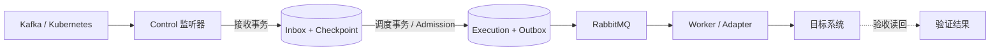

# Design

## Context

状态：**已批准，B0/B1/B2/B3 已通过，下一批 B4，B4/B5 未完成**。2026-10-23 用户已明确选择专用“放弃完成确认”；人工结账规则及相关澄清已通过独立审查；B3 已关闭，B4/B5 的实施与验证仍逐项记录。动机和范围见 [proposal.md](proposal.md)；验证设计见 [validation.md](validation.md)。以下决策已获用户授权实施；各批次验证及独立审查通过后继续。

源码以 `eedda36f9ed1e3ab4f84b0a76532d3916f8ca6d5` 为基线，设计编写时已直接核对该源码。当前规格中部分 `pending`、旧协议描述早于可靠执行实现，本变更仅增加订阅合同，不借机重写无关历史规格。

| 已有事实（路径均相对仓库根） | 对本设计的约束 |
| --- | --- |
| `backend/src/dlr/control/services/reliable_execution.py` 的 `accept_execution` 由调用方提交；`services/execution.py` 的上层 `create_execution` 自带 commit | 订阅转执行必须使用前者的事务边界，不能调用后者拼接原子操作 |
| `services/idempotency.py` 按 Adapter + key 哈希去重，并检查 payload 哈希 | 来源去重独立建模；不可把易变 Envelope 当成稳定源内容 |
| `services/admission.py` 计算 JSON/webhook 等现有类型的逻辑字节 | 事件以 JSON 输入进入执行容量检查，无需新增 Worker 输入类型 |
| `models/execution.py`、`api/executions.py` 限制三种 trigger | `subscription` 需要数据库约束、API、筛选和 Web 一致扩展 |
| `services/adapter_runtime.py` 只锁 running 和已启用 Schedule/Webhook | 单项和批量运行锁都要认识订阅启用及排空状态 |
| Execution 固定 Revision、Worker、输入、资源/重试策略；凭据快照固定引用 | 不宣称凭据真值已冻结；Secret 轮换沿用现有读取语义 |
| 每 Adapter 一个 active Attempt，但可有多个 queued/retry_wait | Slot 不能替代来源顺序屏障，也不能长期被监听器占用 |

## Goals / Non-Goals

**Goals:**

- 用同一管理面和可靠执行底座接入不同来源，保留协议真实语义。
- 在每个崩溃窗口说明由来源还是 DLR 承担下一步责任，并使责任、容量和恢复可观察。
- 第一批 Kafka 可单独交付；第二批 Kubernetes 不反向改变 Kafka 的逐条合同。

**Non-Goals:**

- 不承诺跨 PostgreSQL、来源和任意目标系统的分布式 exactly-once。
- 不提供任意来源网络可达性：首期来源必须能从 Control 访问；隔离网段监听代理以后另设计。
- 不增加业务 Sink、规则引擎、批量业务调用、多来源 fan-in 或并行分区执行器。

## Decisions

### D1. 独立订阅对象，首期绑定关系与触发互斥

`EventSubscription` 是独立资源，绑定一个 `adapter_type=task, run_mode=manual` Adapter。一个 Adapter 至多有一条未删除订阅；数据库约束兜底并发创建。既有 Adapter 类型、run mode 和 InputConfig 枚举不扩展。

- enabled、starting、stopping 或仍有未完接收责任时，普通手动运行、启用 Schedule、改变 Adapter 类型/绑定、删除都被后端拒绝；页面解释为“事件订阅正在接收/排空”。
- 已停用且责任排空后，可按原 InputConfig 手动测试；事件输入不写回 InputConfig。存在订阅时不能改为 schedule/webhook，须先删除已排空订阅。
- 首次启用必须已有保存版本、兼容 Worker、可用凭据引用、合法范围和容量；连接测试只验证连接，不视为启用或业务验收。
- 其他未绑定 Adapter 的手动、定时、Webhook 行为保持不变。

取舍：不把 Kafka/K8s 增为 Adapter 类型，也不在首期支持多个并发触发入口；这样不需要为同一 Adapter 混合输入和顺序竞争定义额外语义。

### D2. Control 运行受限监听器，数据库管理所有权

首期在 Control 后台管理平台内置连接器。阻塞客户端使用专用有界线程/任务预算，不占用 HTTP 事件循环、默认执行线程池或 Worker Slot；不运行用户代码。来源访问凭据只在连接器必要时解密。



每条订阅持有 `owner_id + generation + lease_until`，使用数据库时间；初始租约 30 秒、10 秒续租，网络请求超时有界。接管/停用递增 generation；接收提交、进度更新、Inbox 合并都须比较当前 generation 和有效租约。Kafka 分区另校验当前 assignment generation。旧 owner 失败后停止接收并关闭连接，不自行续旧世代。

来源 ACK 不可能与数据库租约原子提交。Kafka commit 只携带已经持久化的安全位置，并服从消费组 generation；停用竞争中的迟到重复 commit 最多重复已安全位置，不得确认未提交数据。不能把数据库 fence 宣称为外部 RPC 的物理取消。K8s 没有消费者 ACK，持久 cursor 是恢复事实。

备用方案是独立 Listener 服务或 Worker 常驻进程；首期不选，因为会新增部署、认证和跨服务接收协议。若 B0 证明 Control 预算无法满足本稿的低吞吐边界，则停止后续批次、提交设计修订，不能暗中改成无限线程或普通 Adapter 循环。

### D3. 统一有界 Inbox，两次事务承担不同责任

所有来源先写 Inbox，避免 Kafka 直接执行和 K8s 合并形成两套恢复路径。Inbox 是事件接收责任，不是第二个通用工作流引擎。

| 持久对象（逻辑名称） | 最小内容与约束 |
| --- | --- |
| Subscription / ConfigVersion | 当前 desired state、Adapter、source type；不可变配置版本、source epoch、容量及语义模式 |
| ListenerLease / SourceCheckpoint | owner/generation；按来源 shard 保存安全接收位置、Kafka 已确认位置与业务顺序屏障 |
| EventReceipt / PendingDelivery | 唯一源身份、稳定内容哈希、首次接收 Envelope、处理状态、执行关联、合并替代关系；pending 责任受数量/字节上限限制 |
| DeliveryDisposition / completion abandonment | replay/skip/reset 的请求 ID、操作者、原因、旧/新责任关联；专用完成放弃的单份有界审计及不可复活事实；请求幂等且全部计入已有预算 |
| SyncBatch | 固定 subscription/epoch/activation/scope、LIST RV、页/对象计数；控制意图/剩余预留/闭合事实、独立 completion_committed、pending gap 与完成放弃；完成 Execution 外键清空不抹去冻结和处置事实 |

这些是设计逻辑，不强制一对象一表；实际表结构在 B1 审查，但唯一性、事务和留存语义不变。

**接收事务 T1**：先按源身份查已有责任；重复直接返回首次接收事实，不能先受 RabbitMQ readiness 或新 Admission 拦截。新事件在有效所有权下预留 Inbox 数量/字节，存完整可处理输入和版本引用，同时推进该来源可安全恢复的位置；一次 commit 后才允许外部 ACK/commit。网络 I/O 在事务外。

**调度事务 T2**：选择允许越过顺序屏障的 pending，使用内部受信任事件入口调用 `accept_execution`，执行现有 Admission、冻结快照、写 Execution + Outbox + Delivery 关联并释放 pending 计数，一次 commit。Admission/RabbitMQ 暂不可用则保留 pending，有界退避；重启重跑 T2 不得重复建 Execution。Receipt 与 Execution 的容量交接无空档；Outbox 的现有上限继续有效。

全局写锁顺序固定为：`Adapter → Subscription → Lease/Checkpoint（按 shard 排序）→ Receipt/Batch（按 ID 排序）→ Inbox 计数器（订阅后全局）→ 原有 Admission 计数器（Adapter 后全局）→ Execution/Outbox`。只取子集时不得反向取锁；续租只操作 Lease，结果后处理不在已持有 Execution 锁的事务中反取 Subscription。终态观察可通过独立幂等事务推进屏障，短暂滞后只影响吞吐。

考虑过直接建 Execution：Kafka 简单，但不能自然覆盖合并、顺序阻塞和独立来源故障；多一层持久化的成本由统一恢复语义换取，必须同步提供存储上限和治理。

### D4. 固定输入合同，分开源身份、内容与投递事实

`Execution.trigger=subscription`，`input_source_type=json`。公开 `input_snapshot` 仍仅为 `{source_type: json, revision: null}`；订阅版本通过 Envelope 和独立追踪字段表达，不能伪装成 Task InputConfig revision。

`Execution.input` 使用以下封闭的 v1 字段组；具体来源字段由各来源 schema 校验：

```json
{
  "schema": "dlr.event.v1",
  "subscription": {"id": "opaque-id", "config_version": 1, "source_epoch": "opaque-id"},
  "event": {"id": "stable-source-event-id", "kind": "message", "object_key": null},
  "source": {"type": "kafka", "identity": "logical-source-id", "position": {}, "attributes": {}},
  "received_at": "2026-10-23T00:00:00Z",
  "data": {"encoding": "base64", "content_type": "application/octet-stream", "value": ""},
  "sync": null
}
```

- `event.id` 表示源事件；Receipt/Delivery、Execution、Attempt 和人工 replay request 均独立标识。人工重处理关联存于追踪记录，默认不改原 Envelope。
- 去重唯一键：`subscription_id + source_epoch + source_event_id`。凭据轮换或名称修改不换 epoch；连接到另一来源、重置起点/范围必须显式开启新 epoch，并显示可能重复/缺口。
- 稳定内容哈希仅包含源不可变字段及原始内容，不含 `received_at`、连接世代、重投次数、当下配置版本或运行版本。同身份不同内容进入 `event_identity_conflict`，保留首次内容并阻塞该来源 shard。
- 首次 `received_at` 和配置版本持久保存，重投不覆盖；Delivery 的 last_seen/duplicate_count 单独更新。
- Kafka 的 key、value、headers 用 base64 原样编码，重复 header 保留顺序，null 与空字节区分；tombstone 保留 null。平台不解析 Kafka JSON、不静默清洗 NUL；解码/业务校验在 Adapter。K8s 使用 JSON 对象与规范化内容哈希；不支持的 JSON 内容拒绝接管并显示原因。
- 首期只有有界内联内容；不交付文件、外部 URL 或可变对象引用。超限/无法编码在确认前阻塞，不截断后当成功。

来源专有字段固定如下；缺失必填字段拒绝接管，不由 Adapter 猜测来源位置：

| 字段 | Kafka | Kubernetes |
| --- | --- | --- |
| `event.kind` | `message`（tombstone 仍为 message） | `object.present`、`object.removed`、`sync.started`、`sync.completed`、`sync.failed` |
| `event.object_key` | null；业务 key 不代替源事件 ID | 对象事件为 cluster_id/GVR/namespace/UID 的稳定键，控制事件为 null |
| `source.position` | topic、partition、offset（十进制字符串避免 JS 精度损失） | `resource_version` 原样字符串，控制事件无可用 RV 时为 null |
| `source.attributes` | cluster_id、topic_incarnation、timestamp_ms、timestamp_type、key_base64、headers（有序 name/value_base64 数组） | cluster_id、group、version、resource、namespace、name、uid、watch_type；控制事件对象字段为 null |
| `data` | encoding=base64，value 为 value 字节的 base64 或 null | 对象 encoding=json、value 为原始对象；控制事件 encoding=json、value=null |
| `sync` | null | batch_id、scope_fingerprint、phase、read_complete、item_count、failure_code；WATCH 无所属批次时为 null |

源事件 ID 由来源身份元组的规范编码产生稳定哈希；LIST 加 batch_id，控制标记使用 batch_id + kind。哈希计算规则/字段顺序属于 v1 协议，B1 的跨组件测试固定后不得静默改变。示例中的 `opaque-id` 和空 position/attributes 仅说明字段分组，不是可提交的完整 Kafka 输入。

### D5. 版本选择、启停和配置切换

启用时建立 activation，固定已保存 Revision、目标 Worker 和凭据绑定引用；运行期间保存代码、切 Worker/绑定、改变输入和订阅行为配置都被集中 runtime lock 拒绝，唯一例外是下述显式修复流程。Receipt 引用 activation，T2 不重新读取 latest。Execution 创建时仍固定执行资源、重试、语言等既有快照。

凭据快照不保存真值。来源凭据 Secret 轮换后的重连读取当前真值；Adapter 执行凭据沿用现有按引用读取方式。配置审计标明引用变化，秘密值不进入 Envelope、错误详情和日志。

| 操作/状态 | 固定行为 |
| --- | --- |
| 创建 | `desired=disabled`，无监听、无自动接收 |
| 启用 | 校验配置并创建 activation；`starting → listening`，连接失败为 `reconnecting/blocked`，不伪装成处理成功 |
| 停用 | 提交 desired=disabled 和新 generation；收敛在途事务、关闭 listener，停止接收新数据；已提交责任继续 T2/执行 |
| 排空 | listener 已关但还有 pending/非终态 Execution、未闭合批次、待落控制或未结预留，显示 `draining`，包括尚无 Receipt 的空批次；运行配置保持锁定 |
| 修改/删除 | 停用、listener 回收、pending=0、关联 Execution 全终态且批次/控制/预留已结清后允许；失败屏障另须显式处置才能改范围/重启 |
| 控制进程恢复 | 读取 desired state 和有效 lease；接管失效 lease，恢复 pending，保留原 activation/Receipt |
| 克隆 | 新订阅默认停用，不复制 cursor、Receipt、Batch 或激活事实；Kafka 生成独立 group，首次启用重新选择起点 |

未开始执行的责任不能随停用被删除。显式取消 Execution 按现有取消 API；取消/过期同失败一样形成顺序阻塞，不自动当成功。排空期间毒消息可以被审计处置，不能以“改配置”隐式丢弃。名称/描述不影响输入语义，允许独立更新；其他写操作使用 `expected_config_version`，过期返回 409。

**带积压修复代码的受限例外**：普通停用后，若失败屏障阻止排空，操作员可进入显式 `repair` 状态，暂停该订阅新派发并等已有非终态 Execution 收敛。保持 listener 关闭且无 active Attempt 时，允许通过独立修复动作保存新不可变 Revision（只改代码/依赖，不改 Worker、输入、凭据或来源）；该动作不替换 activation 或后续 pending 的版本引用。对阻塞事件选择这个修复 Revision 补处理可在后续 pending 存在时进行；成功后退出 repair 继续排空。后续旧版本责任若再次失败，仍逐项显式修复，不能自动批量改写。每次保存/补处理与派发状态在 Adapter 锁下校验，防止普通运行混入。这样无需先丢弃消息才能修复业务代码。

### D6. 去重、重试、人工重处理和留存

来源断线采用 1–60 秒指数退避加抖动；认证/权限/源身份/协议不支持等确定性失败进入 blocked，配置修复或显式恢复后重试。平台调度容量失败采用 1–30 秒有界退避。Execution 使用现有有界重试策略，默认平台暂态/Worker 丢失；不自动把所有业务异常转成无限重试。用户 Adapter 内重试须有次数和总时限，示例目标使用业务幂等键。

自动重投只返回原责任；人工 replay 才创建新 Delivery/Execution，保存原 Receipt、原 Execution、request_id、原因及操作者。默认复用原输入、Revision、Worker 和凭据引用；选“使用当前配置”须显式指定并展示差异，只在停用且无其他未完责任时允许。D5 的“指定修复 Revision”是单独受限动作，可保留后续 pending，只替换本次补处理代码版本。原版本/Worker 不可用或原内容已过期时分别拒绝，不能静默替换。

正常失败屏障处只允许同一事件的一个补处理链推进；成功后解除屏障，失败继续阻塞。K8s 已冻结完成链另可按 D9 的专用“放弃完成确认”人工结账；它不是 generic skip、成功或 `sync.failed`，不能隐式处置其他失败。已被后续业务越过的旧记录重放只能在停用、排空后执行，标记为带外修复，不承诺保持原业务顺序，不能回退来源 checkpoint。`skip` 需 edit 权限、原因和幂等请求 ID，记录“未处理而跳过”，不伪装成功。原执行始终保留原终态。

放弃完成确认后，禁止为该旧 completed 新建原版本、repair 或当前配置的 Delivery/Execution；重启、reset 后的历史入口、迟到结果观察及维护均遵守持久放弃事实。旧 replay 请求在权限和原参数仍匹配时只读回原 Delivery，旧 abandon 请求只读回原结账结果，不产生新的执行许可。

默认原始内容/可重放历史窗口 7 天，源身份去重元数据 30 天（均从责任进入可清理终态起算）；尚有未完责任、未解决屏障或批次引用的数据不得到期删除。Execution 沿用现有保留规则，但订阅引用增加保护；独立元数据留存能显示“原执行已清理”。超过原文窗口 replay 返回 `event_payload_expired`。

去重不是永久保证。Kafka 正常续读还受已提交的安全 checkpoint 保护，低于该位置的自动重投只归为历史重投，不新建责任；越过窗口的人工历史读取必须显式新 epoch。K8s 没有可数值比较的永久位置屏障，过期后可能再处理，业务仍须幂等。

### D7. 容量、毒消息与可观察性

以下是**待 B0 测量验证的初始产品默认值**，不是已证明吞吐；实施可收紧，不得无审查放宽行为边界。所有数量/字节限制取最先触达者。

| 层 | 初始上限/规则 |
| --- | --- |
| 连接 | 最多 16 条 enabled 订阅；每订阅最多 16 个 Kafka partition 或 1 个 K8s GVR 范围 |
| 接收内存 | 单批最多 16 项；所有监听器共同 64 MiB 应用缓冲预算，客户端原生缓冲也须设界并测量 |
| 单项 | Kafka 原始 key/value/headers 合计 ≤512 KiB；最终 Envelope ≤1 MiB 且不超过现有 Execution JSON 上限；K8s 同样检查最终大小 |
| pending | 每订阅 1,000 项/32 MiB；全局 10,000 项/256 MiB；每秒接管最多 10 项/订阅、50 项/全局，突发不超过相应 1 秒额度 |
| Execution | 继续使用现有 Adapter/global Admission、Outbox、Slot、重试和输出限制 |
| 历史与去重 | 原文每订阅 10,000 项/256 MiB，全局 100,000 项/1 GiB；去重元数据全局最多 500,000 项；均包含被保护记录，不得为了配额提前缩短承诺窗口 |
| 时间与治理 | oldest pending 5 分钟告警，30 分钟停止新接收；恢复至容量 80% 以下且最老 pending <5 分钟后恢复；超过时间不自动丢数据 |

K8s 每订阅至多一个活动全量批次。开启批次前在上述配额内为 3 条生命周期记录（各 ≤8 KiB）预留 pending、原文/历史及源身份去重元数据额度，包含订阅和全局计数；普通对象、WATCH 和其他订阅不能占用预留。T2 释放 pending 不取消未使用的控制预留。整批 LIST 初始上限 5,000 个对象/128 MiB，且实际可用历史预算也必须足够；发现整批越界或历史不足时中止为 `sync.failed`，不用无限暂停等待被本批保护的历史自行释放。pending 暂满但可经 T2 消化时允许正常背压。批次关闭后释放未用预留，对已终态成员解除批次保护，但仍遵守 7/30 天窗口；若保留窗口使下次批次不能启动，明确要求等待治理窗口或缩小范围，不能热循环重开。

ready-control 意图必须持久化，仅指已具备有界落账资格的控制；等待成员成功的 completed 不算 ready。控制接管仍扣同一每订阅 10/s、全局 50/s 窗口，不豁免或放大 rate。普通接管为已 ready 的控制保留下一可用令牌，控制按持久等待时间及稳定 ID 公平挑选；维护使用专门的有界 ready-control 扫描和逐 Batch 短事务，不依赖全 Sub GC 游标偶然轮到。先只读选候选 ID，再按既定锁序获取单批锁，不持全局计数器反取其他 Adapter。已材料化控制遇 Admission 拒绝仍留 Inbox 等 T2，不重复落账或返还已消费 rate。

有限历史预算不能保证任意次失败后的新 replay 都有空间。例如 history_count=4，started/item/completed 已用3且余1控制预留时，completed 已冻结后失败，新的 replay 需要第五份占用而被拒绝；重复同请求返回既有 Delivery 不属于新增占用。用户选择 D9 专用放弃路径来明确结清原责任，不增加带积压限额 API、恢复信用或无限重试承诺。

该动作使用已有 Batch/责任预算中的有界槽，原子结账/转换为一份至多 8 KiB 的 abandon 审计实际占用；不要求额外空位，不免计费，不复制原 Envelope，也不删除原历史。审计绑定 actor/reason/request_id 和期望责任，按既有元数据 30 天窗口及引用保护保留；重复请求不追加第二行。实际账本、只读核对和显式修复必须可重建审计占用及 remaining reserve。未用 reserve 仅结账一次，已用 history/dedupe 按合法窗口回收。即使原批能结账，达到产品 max 时新批仍可能等待留存治理，不承诺立即重新接收。

未闭合 Batch、待控制意图和未结预留即使尚无 Receipt 也受运行锁/GC保护。来源停用或功能关闭只停止新接收，既有 Batch 控制由有界维护恢复，不依赖旧 owner finally；不完整 LIST 走 failed 收敛，已读完整的有效批次仍可合法完成。Batch 本身有界 GC，保留 Batch 对 activation/config/凭据引用的保护；不能仅按 state=failed 判断责任已闭合，独立冻结/放弃事实不随完成 Execution 外键清空而丢失。

pending 转 Execution 后仍计入原文/历史预算；终态和合并后的审计行、Outbox、Execution 副本也计入实际存储监控，逻辑 quota 不等于物理磁盘上限。记录占用必须随事务更新、定期只读核对并可修复，不能只数 UI 中的 pending。

达到 pending/历史/元数据上限时暂停来源新接收，先清理已满足窗口且无引用的数据；若仍满则保持 backpressure，而不是删除未满保留期的数据。接收已被确认但长期失败的责任可持续占满预算，须由操作员修复或明确处置。

超大、非法内容或身份冲突只记录有界故障摘要（身份、尺寸、哈希或不可计算原因），标记 `blocked_unaccepted`，不将它计为已接管完整消息，不 ACK；Kafka 暂停该 partition，显式 skip 后才可推进。K8s 停止该范围并标记 gap/需重新 LIST；失败批次不得触发清理。故障摘要也有计数上限，重复同一故障聚合计数，避免错误表无限长。

状态分成 desired、connection、delivery 三维。展示 source lag（可获得时）、accepted/pending/processing/succeeded/failed/replayed/skipped/coalesced、最老时间、数量和字节、最近错误、epoch/配置版本、源身份到 Execution/Attempt 的关联。`succeeded` 只表示 Adapter 报告成功；真实目标读回是验收证据，不由连接灯代替。

10 条/秒会产生 864,000 条/天，远超上述历史预算；10 条/秒是接管速率上限，不是持续吞吐承诺。首期面向低频集成；B0/B3 必须给出样例执行时长、稳态速率、数据库日增长与保留策略的容量估计。

### D8. Kafka：逐条接管，分区内按成功顺序推进

首批仅 `per_event + partition_serial`，精确 topic allowlist；不提供 regex、批量业务调用或跨 partition 顺序。一个订阅消费组专用；本部署禁止重复 source/group 绑定，外部消费者共享组不在支持范围，检测到时阻塞并提示迁移到独立组。

- 首次启用必须选择 `earliest` 或 `latest`，先持久化每分区解析出的起点再消费，重启不重新解释 latest；已有位置优先。运行期禁止 `auto.offset.reset` 静默改位置。关闭客户端自动提交和会超前的自动 offset store。
- 源身份包含验证的 cluster identity、topic incarnation、partition、offset。topic incarnation 优先使用源可验证身份；无法可靠获取/验证时该能力不能声称自动检测重建，需显式登记 epoch，topic 删除重建须停用重置。B0 固定客户端能支持的检测范围，错配或倒退进入 blocked。
- T1 按 partition 接收顺序建立连续**已消费记录**的安全前沿；offset 可因压缩/事务出现空洞，不按整数补洞。提交到 Kafka 的是安全的下一读取位置，不能跳过已读但尚未持久化的前序记录。
- 重新分配时暂停被撤销 partition，收敛在途事务，只提交已安全持久化位置；新 assignment 从 DLR checkpoint 恢复。Broker 的提交位置小于数据库位置可重复确认；若大于数据库安全位置则阻塞诊断，不盲信来源位置跳过责任。
- Kafka commit 后即由 Inbox 负责业务处理。每 partition 最多一个未完成的业务 Delivery；只有当前记录成功或被显式 skip，下一条才可创建 Execution。`retry_wait/dead_letter/cancelled/expired` 期间后续不越过；其他 partition 可继续，但最终仍服从单 Adapter Slot。
- cursor 已超出 retention 时报告 `source_history_gap`，暂停该 shard；用户审查缺口后显式 reset earliest/latest 并建立新 epoch。DLR 已接管的旧责任先处理或处置，不能随 reset 丢弃。
- 默认 `read_committed`；事务隔离、rebalance、TLS/SASL 的实际支持矩阵与精确客户端版本在 B0 固定。生产首批认证候选 TLS + SASL/SCRAM；其他机制未验收不展示可用。

为什么不“业务成功才 commit”：那会把长业务执行与 poll/组稳定性绑定，并让断线恢复绕过持久责任。先接管后确认与数据库业务顺序屏障是两个独立进度。

### D9. Kubernetes：默认保留变化，状态合并显式选择

一条订阅对应稳定 `cluster_id + GVR + namespace范围 + selectors`，首期一个 GVR，支持完整范围 LIST/WATCH 的资源；无一致 LIST 或权限不足的聚合 API 不声称支持。`cluster_id` 是配置的稳定逻辑身份并结合 server/有效 CA 信任校验，不声称原生全局 UUID。server 或有效 CA 信任范围改变、换集群及范围变化都须先停用、实际关闭并结清旧责任，再显式新 scope/epoch；同一凭据引用的 token 值轮换保持 epoch/RV。首批验证 Pod/Deployment，其他 GVR 逐项验证而非宣称通用兼容。

模式：

- `per_event`（默认）：保留每条已可靠接收的 LIST item / WATCH 变化，不做隐式合并。仍然只保证当前状态可重建，不能补回源已过期历史。
- `state_sync`（显式 opt-in）：仅 WATCH 中尚未转 Execution 的同 `cluster_id + GVR + namespace + UID` 更新可合并；保留 last event、合并次数、起止源身份和 superseded 审计。LIST 项、批次标记、不同 UID、删除/离开范围边界不合并。已创建 Execution 不改；执行期间新变化形成下一 pending。

`resourceVersion` 原样保存为不透明字符串，不数值比较、不跨对象排序。WATCH 去重身份为 epoch/GVR/UID/event type/RV；LIST item 的身份另含 batch_id，避免新批次的相同 RV 被旧批次去重而漏掉对账成员。顺序使用本地持久接收序号；示例 Adapter 以稳定 cluster_id + UID 写目标，目标按 UID 和业务条件保护旧任务，不能只按 name 删除。

LIST/WATCH 流程：

1. 新建 `batch_id + scope_fingerprint`，发送有幂等身份的 `sync.started`；正常有效批次中，started成功后才能派发LIST对象；失效批次另按failed处置后的排空规则收敛。
2. 分页 LIST 保持同一快照，持久化每页对象责任后记录页进度；最终页完成才标记 `read_complete`。对象可边读边处理，不能把整轮全量塞内存。
3. 从 LIST collection RV 建立 WATCH。后续 WATCH 事件可有界接管，但业务派发等待当前批次完成屏障。
4. 只有所有页成功、所有LIST对象最新责任成功、该批未failed/superseded，才派发 `sync.completed`。该消息包含 batch_id、scope、总量和读取完成事实；Adapter 在目标侧核对 begin/batch 写入记录，才可执行受管范围内对账。正常路径中完成事件业务成功后才放行缓冲 WATCH；下述专用人工放弃是唯一例外，不等同成功对账。
5. 部分页失败、403、超时、continue token 失效或 LIST/WATCH 衔接发现历史缺口，批次置 failed/superseded，使用预留控制额度记录 `sync.failed`，永不派发成功完成标记。该失败标记终结的是全量对账资格；它经处理或显式处置后打开失败批次的派发屏障，已接管 LIST 对象和 WATCH 按原接收序号继续排空，不能继续等待不存在的 `sync.completed`。普通对象失败仍按业务失败屏障处置。已写目标的部分对象不回滚为不存在；重试另开 batch，旧批不能复活。

WATCH 断线从最后安全持久 RV 续接。`410 Gone` 明确记录 history gap，终结尚未冻结完成资格批次的对账资格，按上述失败路径排空旧责任后重新 LIST；已冻结的批次按下一段规则收敛。不恢复全部历史。失败控制标记可以越过批次完成等待及早期普通失败，但不得越过正在执行的 Attempt；其重试耗尽须明确处置才能继续。`sync.failed` 业务失败可显式 generic skip，审计为未处理且不恢复清理资格；这不放宽已冻结 completed 的 generic skip 禁令。若控制临时占用 checkpoint blocker，结账后必须重算并恢复其他普通 failed/active 屏障及 repair 入口，不能直接清空。BOOKMARK 仅在之前事件全部持久化后推进接收位置，不创建业务 Execution，不依赖固定发送周期。错误事件不能当对象删除。

批次完成资格在 completed 的 T2 事务中锁定并冻结（`completion_committed`），与 failed/superseded 转换互斥。若失效先提交则不能创建 completed；若 completed 先提交，随后 WATCH 缺口归为下一轮恢复，不能追溯撤回已创建执行的资格。正常路径中 completed 的业务失败按原快照受限补处理并阻塞后续；可选择以下专用人工放弃结账，但不能再生成同批 failed 去取消可能已发生的目标副作用。`sync.failed` 只撤销对账清理资格，示例 Adapter 仍允许旧批已接管对象的幂等写入和排空。

普通逐条失败保持当前订阅后续业务屏障；控制只有规定的生命周期优先及专用完成放弃例外，不能吞掉普通失败。LIST 成员最新责任失败时不得 completed；若完整页证据仍有效且该批未失效，显式 repair/replay 的最新责任成功后可重新检查全员成功，历史失败本身不永久废除资格。对 LIST 对象或 sync.started 显式 skip 则必须令该批永久失效，不能当作全量成功；后续补处理成功也不复活旧批，清理须等新完整批次。范围变更创建新 scope/epoch，旧范围退出对象如何处理由业务明确决定，平台不自动发送全局删除。带 selector 的 `DELETED` 可能仅表示对象离开选择范围，Adapter 不能据此声称 Kubernetes 对象物理消失。

#### 专用人工例外：放弃完成确认

用户已明确选择此方案。它仅适用于 `completion_committed=true`、完成结果仍未确认且未被其他处置终结的 completed 链。正常路径继续要求 completed 业务成功；generic skip 在已冻结 completed 上一律拒绝。专用 `abandon-completion` 记录“放弃后续补处理 / 业务结果未确认”，不是成功、generic skip 或同批 `sync.failed`。

- 必须 desired=disabled、原生 listener 已确认关闭，且该订阅所有关联 Execution 均已终态；queued/running/retry_wait 任一存在都拒绝。edit 权限仍由 Adapter ACL决定。操作不取消已有 Execution，不以 Execution 终态证明远端不存在迟到副作用。
- 请求绑定 `expected_config_version`、Batch/epoch、completed Receipt、期望最新 Delivery ID/责任序号及其 Execution 关联快照（包括 null）、actor、非空 reason、request_id 和明确影响确认；actor取认证主体。与 replay/T2/observe 共用 Adapter→Subscription 及既定后续锁序。未冻结、已成功、已被其他处置终结、跨批次/epoch或责任/执行关联已变化均冲突，零副作用；资格须读取真实 Execution 结果，不能因 Receipt/Delivery 成功投影滞后而放弃已成功责任。旧请求的幂等读回另按原参数和权限处理。
- 已冻结完成链的最新 replay 若仍 pending 且 execution_id=null，可在同一处置事务中标记为未执行放弃，释放它一次 pending count/bytes，保留该 Delivery 的历史/dedupe。T2 先提交（即使已快速终态）或新 replay 先改变最新责任，旧处置均冲突；放弃先提交则之后 T2 不得创建 Execution/Outbox。事务失败时处置、pending与预留结账一起回滚。
- 保留 completion_committed、原 Envelope、原失败 Delivery/Execution 和原终态，追加独立持久放弃事实；只解除 completion 屏障，重算并保留其他普通失败和原 repair 入口。已接管 WATCH 仍按本地持久序号排空，旧普通失败照常显式修复/处置。
- 放弃后，dispatch、原/repair/current-config 新 replay、迟到 observe、后台恢复及 reset 后历史调用都不得复活旧 completed；旧 replay 请求只读回其原 Delivery，旧放弃请求只读回同一次结账结果。重复请求不重复扣/放 pending、占审计或结账 reserve；改变actor、对象、理由或期望责任后复用request_id须冲突。
- D7 的单份有界且已计费审计使满额原批可明确结账，原历史不提前删除；仅释放未用 reserve，不自动解除其他责任或运行锁。动作不自动 enable、不新建 LIST；旧责任全结清后，用户才可沿现有配置路径调整收紧限额并显式启用新批次，产品 max/合法留存仍可能阻止新批立即开始。

目标示例必须持久化每 scope/batch 的 generation 与控制幂等结果，generation独立于opaque RV。新批 started 生效后，迟到或重复的旧 completed 不能清理新批数据；同一控制重试只返回其既有结果，不重复清理。平台禁止新 replay 不代表远端请求被物理撤回。UI 必须明确目标可能已部分执行、放弃不能回滚，且取消尚未派发的本次补处理后，下一完整批次仍须重新核对目标。

### D10. API、权限与产品呈现

建议资源面：`/api/event-subscriptions` 的列表/创建/详情/更新/删除，`/{id}/enable`、`disable`、`resume`、`reset`、`events`，以及事件的 `replay`、`skip`、专用 `abandon-completion` 和受限 `repair` 进入/退出与修复版本保存。enable/disable 等动作、配置写入及处置请求携带 expected config version 或幂等 request_id；稳定冲突由后端返回，不依赖前端禁用按钮。

首期能力集中在 Adapter“运行设置 → 事件订阅”；全局列表支持来源、连接/处理状态、Adapter 筛选和跳转。事件详情关联原事件、执行与重处理链，并分别显示完成冻结、业务成功、失效和人工放弃；放弃确认展示原/最新责任、执行关联与不可回滚影响。普通 Execution 历史保持只读，重处理及人工放弃只在订阅的独立授权动作中进行。

复用绑定 Adapter 的 view/edit 权限：view 可查看已授权摘要和执行详情；edit 才可配置、启停、重放、skip/reset 和专用完成放弃，且必须有凭据引用权限；全局列表先按权限过滤再分页/计数，禁止通过 ID 查询泄露。Secret 不返回前端；来源 payload 作为业务输入受现有详情权限保护，不进入普通平台日志或 AI 自动上下文。连接地址只在有权配置页展示，日志为脱敏摘要。

新增稳定错误至少覆盖 `subscription_binding_conflict`、`subscription_draining`、`subscription_config_conflict`、`subscription_owner_stale`、`source_history_gap`、`event_identity_conflict`、`event_payload_too_large`、`event_payload_expired`、`subscription_capacity_exceeded`、`source_not_available`；错误 code 不翻译，用户解释支持 zh-CN/en。未交付来源不出现在可启用选项中。

## Risks / Trade-offs

| 风险/代价 | 处置 |
| --- | --- |
| Inbox 增加一次持久化和治理复杂度 | 一条公共 T1/T2 路径；以崩溃窗口和配额交接测试为合并门槛 |
| Control 与外部客户端共享资源 | 全局连接/内存预算、超时、专用执行池；测量 HTTP 延迟与 RSS，不满足则回到设计审查 |
| partition 严格顺序遇毒消息会停滞 | 清楚显示阻塞身份和补处理/skip，不以吞吐为由悄悄越过 |
| K8s 批次与业务目标不在同一事务 | begin/item/finish 业务幂等及目标代次保护；完成屏障只是必要条件，目标 Adapter 还须核对写入事实；人工放弃不回滚或伪造目标结果 |
| 有限历史容量耗尽使完成补处理无空间 | 专用放弃用已有预算内有界审计结清原完成责任；保留历史、原终态和冻结事实，新批仍服从产品 max 与留存治理 |
| 目标写入成功而响应丢失 | 同一业务幂等键重试并读回；平台执行去重不替代目标幂等 |
| 低频工具被误用于高吞吐 | 默认配额、暂停策略、容量估计和实测适用范围共同交付 |
| 旧应用不识别新 trigger/责任表 | 新旧版本兼容性必须单独验证，不承诺裸二进制回滚 |

## Migration Plan

批次划分见 [tasks.md](tasks.md)：B0 技术与容量门槛 → B1 公共责任模型 → B2 Kafka 连接器 → B3 Kafka 产品验收 → B4 K8s 连接器/批次 → B5 K8s 产品验收。B3 完成 Kafka 独立阶段验收，B5 完成 Kubernetes 验收；按本轮授权统一在一个 PR 审查和合并，发布另行授权。

部署时先备份并验证可读，暂停新接收，使用向前 Alembic 迁移新增结构与 trigger 约束；升级 Control/Web，再核验现有 Worker 可消费 JSON 输入和新 trigger。任何不兼容必须在 B0/B1 被发现并列为同批升级项。功能默认关闭，既有 Adapter 不生成订阅；独立来源验收通过后才对用户开放相应类型。

回退首选关闭订阅接收开关，保持支持新表的当前 Control 排空/修复已接管责任，保留持久卷、Token、Master Key 和所有 checkpoint。回退旧镜像必须先证明它能保留且读取相关历史，并确认无未完订阅责任；未证明则只回退功能开关或修复前进。禁止降级删除新表、清空已确认 Inbox 或恢复旧数据库快照来伪造回退成功。

实施批次中须将触及的产品/API/部署说明按已验收来源更新；本轮不修改描述“当前已支持”的主文档，不同步/归档本变更到正式规格。

## Open Questions

仅保留不改变上述合同的实施选项：客户端精确补丁版本及 Python 3.13 wheel 可用性、真实验收环境版本、页面文案/列宽和内部表拆分。B0 必须记录支持矩阵与预算测量；未有证据就不进入对应来源实现，不将这些问题留到上线后。

## References

- [Issue #219](https://github.com/john-ops-lab/DataLinkRuntime/issues/219)：本设计的产品范围。
- [Kafka Consumer 4.1](https://kafka.apache.org/41/javadoc/org/apache/kafka/clients/consumer/KafkaConsumer.html)：手动 commit、下一读取位置、offset 空洞、pause 与 rebalance；Java 文档提供协议行为依据，不是 Python 客户端选型结论。
- [Kubernetes API concepts](https://kubernetes.io/docs/reference/using-api/api-concepts/)：LIST/WATCH、resourceVersion、分页与 410 恢复。
- [Windmill Kafka triggers](https://www.windmill.dev/docs/triggers/kafka_triggers)：服务器监听、不占 Worker 的职责划分参考；其队列确认规则不直接充当 DLR 持久接收证明。

参考资料核对日期：2026-10-23。初稿仅定义设计；后续实施与实测状态以 [tasks.md](tasks.md) 和各批次审查记录为准，本次规划修订不代表新增测试已通过。
