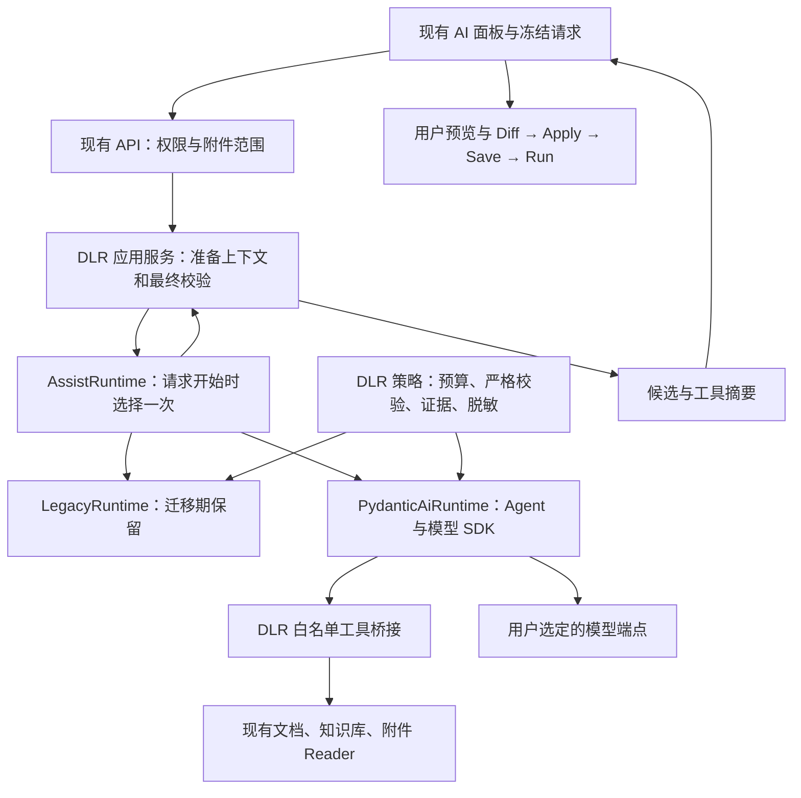

# Design

## Context

AI 入口目前为同步 FastAPI 路由。原基线中 `services/ai.py` 约 2,507 行、`ai/providers.py` 约 1,621 行、`ai/tools.py` 约 1,170 行，同时承担通用编排和 DLR 特有规则，不能按文件整体删除。行数仅用于定位维护负担，不作为节省比例、迁移完成或收益达标的唯一指标。

原规划运行基线为 Python 3.13，并记录锁文件中的 Pydantic 2.13.4、FastAPI 0.141.1、SQLAlchemy 2.0.51；实施时从实际锁文件重新确认，不顺带升级整个后端。现有 14 个 Provider 标识涉及 OpenAI-compatible、Anthropic、Gemini 三类协议。附件转换、临时存储、权限和 Worker 执行链继续保留自己的边界。

原参考为 PowerContext `powercontext-v1.3.0` 和 Pydantic AI `v2.57.0`。它们是研究锚点和候选，不能据此认为 DLR 已验证兼容。滚动文档可能晚于候选版本，必须核对锁定版本的真实 API；见[参考依据](references.md)。

## Goals / Non-Goals

**Goals：** 通用模型/消息/循环/输出机制交给框架；业务规则单独测试；用户不重录配置；新旧共用契约用例并可回退；最终保留一个正式实现；新增同协议模型或只读工具时主要修改配置/处理器和测试；用实际删除范围与扩展演示证明维护收益。

**Non-Goals：** 不要求自然语言逐字相同；结构化输出不替代事实校验；不迁移 Worker/调度器；不建立通用 Agent 平台、第二套公共消息标准、插件总线或工作流 DSL；不恢复已移除的服务器聊天、自动摘要或跨刷新记忆；不改变只读工具及人工应用边界；不把 #202/#215 的所有模型失败顺带纳入修复。

## Decisions

### D1. 借鉴 PowerContext 的职责划分，优先采用 Pydantic AI Core

| 参考原则 | DLR 设计 | 边界 |
|---|---|---|
| 框架依赖限制在接入层 | `ai/runtime/pydantic_ai/` 为运行代码中导入框架和模型 SDK 的唯一接入目录 | API、领域策略、工具处理器和 Worker 不接收框架对象；框架专用测试可直接引用公开 API |
| 模型只产生候选 | DLR 校验后才接纳 Candidate | 仍由用户预览、Diff、Apply、Save、Run |
| 显式组装模型、凭据和客户端 | 从现有设置与 Secret Store 冻结请求配置 | 不读取框架默认模型或环境备用 Key，不自动切供应商 |
| 错误转为领域错误 | 映射既有 HTTP 状态、错误码和安全参数 | 不把原始异常、Prompt、推理或凭据送给用户 |
| 推理有界，业务状态归领域 | DLR 持有预算、时限、证据和权限判定 | 框架 run 完成不等于任务完成 |

PowerContext 参考实现主要展示有界结构化推理；不能直接证明 DLR 的多轮工具、媒体和严格协议边界可落地。只借鉴分层，不安装整个 PowerContext，也不照搬其 Memory、存储或重试参数。

候选依赖为 `pydantic-ai-slim[openai,anthropic,google]`，从原候选版本开始核验，必要时有据调整，最终固定实际通过的版本及传递依赖。许可和依赖变动按项目门禁检查。初期不引入 Harness 扩展包、LangGraph、LiteLLM、Dify、向量数据库或新常驻服务。

完整迁移目标不采用“只接 SDK、永久保留原循环”，也不直接接受框架默认的重试/并发/解析/追踪。若 B0 结果只支持薄 SDK 接入且收益更清晰，可另行审查较小范围方案；不得把它记作本单全量迁移完成。

### D2. 外部接口稳定，内部只设一个运行实现边界

拟定内部接口：`AssistRuntime.execute(prepared_request, resources) -> RuntimeOutcome`。这仍是设计接口，准备数据复用现有 schema/数据类，不复制公共 DTO。

- `prepared_request`：冻结的消息、WorkingCopy、历史片段、配置、意图、附件标识和能力选择，不含活 ORM 对象。
- `resources`：受限凭据访问、Session 工厂、Reader、预算及审计器；不向模型暴露任意数据库或文件系统接口。
- `RuntimeOutcome`：输出、真实工具轨迹、预算与证据结果，不直接向 API 序列化框架消息或 SDK 异常。
- 两个实现均经过同一最终领域校验，公共响应保持 `AiAssistResponse`。

初期只有运行接口、模型能力映射、工具桥接三个扩展点。错误、解析、预算为相关策略模块，不另造跨产品 SDK。

### D3. 模块按职责迁移，删除目标是重复机制

| 当前模块 | 处理方式 | 最终责任 |
|---|---|---|
| `control/api/ai.py`、`control/schemas/ai.py` | 保留；仅必要内部委托/生命周期适配 | HTTP、RBAC、请求响应兼容 |
| `control/services/ai.py` | 先提取领域策略，再缩减 | 设置、准备请求、调用运行器、最终判定 |
| `control/ai/providers.py` | 分开配置/能力/Catalog 与 Assist 协议，后期删除重复编码解码 | 薄配置映射和目录查询；Assist 使用 SDK |
| `control/ai/runtime/` | 新增最小 contracts、迁移期 legacy、运行选择 | 隔离实现，不增加第二套 API |
| `control/ai/runtime/pydantic_ai/` | 运行器、模型工厂、工具桥接、hooks、传输守卫 | 框架/SDK 接入，不复写通用循环 |
| `control/ai/tools.py` | 保留白名单、严格参数、处理器、脱敏，拆开通用调度 | 领域工具行为和旧计数语义 |
| `prompt_builder.py`、`prompts/` | 保持最新基线的指令内容及上下文含义 | 含 #215 的服务端语言权威和完整代码注释规则 |
| `context_budget.py` | 保留算法和裁剪规则，适配实际 SDK 载荷 | 每次调用前的预算 |
| `knowledge.py`、`dlr_docs.py` | 复用 | 知识源、证据、只读文档 |
| `attachments.py`、`attachment_documents.py`、`attachment_reading.py`、`attachment_store.py` | 复用，增加媒体桥接 | 转换、范围、pin、读取与回收 |
| `diagnostics.py`、`tool_audit.py` | 保留错误语义和脱敏格式 | 真实且稳定的诊断 |
| AI 面板及模型设置面板 | 保留最新行为，仅必要适配 | 临时状态、Retry/Regenerate、只读预览、Diff/Apply、帮助 |
| Worker、执行队列、依赖管理、托管输入 | 不迁移 | 原执行和数据生命周期 |

路径为建议布局，可以合并小文件。模型列表和草稿连接测试不会因引入 Agent 自动统一；保留薄 `ProviderCatalog` 职责，不为删除整个 `providers.py` 破坏原功能。B3/B5 必须列出“删除、保留、新增”的机制和原因，不能仅移动文件后宣称减负。

### D4. 保留三协议、输出模式和准确能力判断

DLR 继续按 Provider 标识、协议、准确模型 ID、端点和明确配置解析能力，再映射框架 profile/model settings。自定义 URL 不保证框架能识别真实能力，不按品牌推断。

| 协议 | 接入方向 | 必须保留 |
|---|---|---|
| OpenAI-compatible | OpenAI Chat Completions 模型适配及 SDK | 不擅自切 Responses API；保留 base URL、网关前缀、路径和非 OpenAI 参数差异 |
| Anthropic | Anthropic 适配及 SDK | 工具回合签名/continuation 保真，私有推理不展示、不持久化 |
| Gemini | Google 适配及 SDK | 多模态 parts、工具关联、端点与原鉴权语义 |

`json_schema`、`json_object`、`prompt_only` 保持实际 wire 模式；NativeOutput/PromptedOutput 仅为待验证映射。不得默认切成 ToolOutput，额外增加“提交结果工具”、改变预算或要求原本无工具能力的模型调用工具。

模型可见 schema 保持 code-only；本地接受的遗留配置回显不重新成为模型可写字段。核对 PromptedOutput 的 schema 注入，避免重复指令、冲突或未计入预算的增量。

保留 MiniMax 已有 `prompt_only` / `reasoning_split=false`、Kimi Code 特定端点/模型的输出策略；不把 Moonshot 平台与 Kimi Code 混同，不把“支持文件”等同 native PDF。

每请求只使用已选模型，凭据轮换只影响后续请求。SDK 隐式重试先关闭；保留的特定重试须由统一预算批准并留痕。框架逻辑回合与实际 HTTP 请求分别统计，SDK continuation/polling 等隐含请求不得漏记；本次不启用新的后台模型模式或跨供应商降级。

### D5. 三个检查阶段分别验证，不能依赖解析后的对象补救

| 阶段 | 检查内容 | 正确拦截位置 |
|---|---|---|
| 原始 HTTP envelope | body 有界、严格 JSON、重复 key、非有限数、传输分类 | SDK 解码 JSON 之前的公开 client/transport 扩展点 |
| 模型内容/工具参数 | 原始最终文本与原始参数的严格 JSON、Unicode、类型、额外字段、secret reflection | 框架 coercion/输出解析前；对象型工具参数还依赖上一层保护 |
| 领域结果 | Candidate、配置回显、附件/知识证据、权限、时限和 task_status | 框架输出之后的 DLR 最终校验 |

模型响应 hook 接收到的框架 `ModelResponse` 不等于原始 HTTP 字节，不能用它证明外层重复键已被检查。`dict` 中已经丢失的重复 key 无法通过再次序列化恢复。B0 必须逐 SDK 记录实际拦截 API、顺序、可获取的原始数据以及失败样例；见[官方 Hooks 文档](https://pydantic.dev/docs/ai/core-concepts/hooks/)。

优先使用公开 hooks、模型/工具扩展点和可注入 client/transport，不用 monkey patch、私有属性或 fork。原始内容仅在请求内存短暂存在。某组合无法保持检查阶段时，不进入新实现；不能以最终类型正确为由放宽标准。

格式纠正仍至多一次，仅限 `final_json` / `output_schema`，共享原预算和有效上下文，追加固定错误阶段/原因，禁用工具；非法原文和带敏感信息的 ValidationError 不回送模型。Unicode、泄密、配置、传输错误不可纠正。

框架自动输出纠正关闭。尤其不能直接使用会把失败响应留在历史中的 ModelRetry 路径绕过“不回送非法原文”要求；具体公共控制接口由锁定版本实验确认。DLR 批准一次无工具纠正或有限收尾，可在接入内分成有界调用，但必须共享请求身份、Reader、审计、预算，不能重新获得完整限额。

### D6. Agent 驱动循环，DLR 保留分阶段预算与拒绝语义

| 阶段 | DLR 规则 | 待验证接入点 |
|---|---|---|
| 模型调用前 | 剩余时限、上下文、工具集、知识阶段、输出策略 | model request hooks |
| 模型响应后 | 模型内容校验、整批数量预检查、白名单、continuation | response/node/tool preparation 扩展点；不替代 HTTP 层检查 |
| 工具前后 | 参数、顺序、重复指纹、ACL、精确记账、结果尺寸、连续失败 | 工具桥接与 tool hooks |
| 输出完成 | 附件实际阅读、知识完成、Candidate 合法性 | output hooks 与领域判定 |
| 安全停止 | 剩余预算内一次禁工具收尾，或服务器 fallback | 有界额外调用，不复写通用循环 |

**旧实现的 `total_tool_calls` 是 dispatcher 返回结果并进入 `record_execution()` 的预算口径，不能直接解释为 handler 真正执行次数。** 到达 dispatcher 的未知工具或参数错误也会产生 ToolExecution 并消耗该预算；dispatcher 前的知识顺序拒绝、重复指纹拦截则走不同分支。已核对的源码见[状态与预算](https://github.com/john-ops-lab/DataLinkRuntime/blob/5fc95945b894fbc07aae7fc873aac91a2e26fabc/backend/src/dlr/control/services/ai.py#L97-L190)、[调用分支](https://github.com/john-ops-lab/DataLinkRuntime/blob/5fc95945b894fbc07aae7fc873aac91a2e26fabc/backend/src/dlr/control/services/ai.py#L2239-L2365)和[dispatcher](https://github.com/john-ops-lab/DataLinkRuntime/blob/5fc95945b894fbc07aae7fc873aac91a2e26fabc/backend/src/dlr/control/ai/tools.py#L1042-L1150)。

验收需区分以下事实；可以通过既有状态和事件轨迹断言，不强制新增四套产品计数器或公共字段：

| 观察维度 | 含义 |
|---|---|
| 模型提出的调用 | 已通过协议规范化的 batch 中调用数量；是整批预检查的输入，不代表允许执行 |
| DLR 调度预算 | 旧 `total_tool_calls`：dispatcher 返回 ToolExecution 后记账，包括未知工具/坏参数等拒绝结果 |
| handler 真正启动 | 处理函数是否实际进入；未执行、排队失败和已启动但超时必须区分 |
| 结果/证据 | 成功、失败、拦截、未执行；工具成功也不自动等于附件或知识任务完成 |

#### 计数与停止矩阵

| 场景（均受前置阶段约束） | 调度预算增量 | handler 启动 | 连续失败/停止规则 |
|---|---:|---|---|
| dispatcher 返回成功结果 | +1 | 按真实轨迹 | 连续失败清零；再按旧顺序检查累计结果和调用上限 |
| 到达 dispatcher 的未知工具/参数错误/知识开关拒绝 | +1 | 否 | 失败 +1；保留累计结果和停止优先级 |
| dispatcher 返回执行失败/超时 | +1 | 按真实轨迹，不能一概记已启动或已结束 | 失败 +1；资源结束另行跟踪 |
| dispatcher 前知识检索顺序拒绝 | 0 | 否 | `record_protocol_failure()` 增加失败；达到阈值走知识顺序停止 |
| 重复指纹拦截 | 0 | 否 | 设置 duplicate 停止，不冒充 handler 失败 |
| 整批超过回合或调用预算 | 0 | 否，整批不启动 | 拒绝 batch；该 batch 不增加 tool_rounds |
| batch 中途触发停止后的剩余调用 | 0 | 否 | 不能由框架消息配对修补伪造成功或增加预算 |
| 已接纳 batch 内全部调用在 dispatcher 前被拦截 | 按各分支，可能为 0 | 否 | 已接纳 batch 的 tool_rounds 仍已增加一次 |

保留 **最多 8 个通过 `begin_round()` 预检查的工具 batch、16 次上述调度预算、单请求工具并发 1、连续失败阈值 3**。整批检查按 `当前 total_tool_calls + incoming batch 数量`，不能先减去预测会失败/被拦截的调用。非法协议、空工具数组及工具能力不支持的更早分支另按现有错误契约验证，不强行归入 dispatcher 计数。

累计结果继续使用 `execution.result_size` 的 UTF-8 字节数，即使旧变量名含 chars。`record_execution()` 的旧停止优先级为累计结果超限 → 连续失败 → 调用上限；知识状态和 deadline 的后续覆盖/保留规则也须用固定轨迹测试，不随手重排。

工具桥接复用原 JSON Schema、严格验证和处理器。`Tool.from_schema` 会跳过自动 schema 校验，DLR 仍需验证原始参数；公开 API 中的自定义 validator 是否在所选版本存在、执行时机是否满足要求，要由 B0 证明。框架提前拒绝未知工具/参数错误时，也必须产生与旧阶段对应的领域记账和稳定结果，不能漏记、重复记账或额外触发默认纠正。

`UsageLimits` 仅作辅助保护；request_limit 不等于工具 batch 数，框架 tool-call 数不等于 DLR 调度预算或 handler 启动数。补读、知识纠正、格式纠正各有原语义。任何额外请求上限须从旧有限状态路径推导，证明不截断合法流程。

全运行工具串行须在执行层验证；仅设置 provider 的 `parallel_tool_calls=false` 不足。单工具 `sequential=True` 和全运行串行的语义可能不同，按锁定版本公开 API 明确配置并核对实际启动顺序；参考[工具 API](https://pydantic.dev/docs/ai/api/pydantic-ai/tools/)。

文字与工具混合响应仍按旧工具回合语义处理；中途停止时保留已执行/拒绝/未执行的区别和合法消息关联，不让默认提前结束跳过必要工具。

**禁止把通用循环拆散到多个 hook 中重新实现。** 审查以职责和调用轨迹为准，不以“没有 while 关键字”为充分证明。领域策略只返回允许、拒绝、纠正或收尾决策；通用迭代由 Agent 驱动，每个自定义分支对应 C/G 要求。

### D7. 请求级异步运行与单进程共享资源边界

第一期保留同步 HTTP 路由/应用服务，在当前工作线程内显式进入请求级事件循环；Agent、异步 SDK client 的创建/关闭都在该 loop 内。不跨 loop 共享异步 client，不在已有 loop 内嵌套 run_sync。它会牺牲跨请求连接池复用，是否可接受由 B0/L5 测量，不提前承诺更快。

- 在路由原线程准备配置、凭据和不可变数据，不跨线程传活 ORM 对象。
- 工具需数据库时，由执行线程通过 Session 工厂创建短会话；ACL 重查读取当前状态，不用旧 Session 缓存掩盖撤权。
- Reader scope/pin 生命周期由 DLR 管理；同步读取/转换继续走有界线程或子进程设施，不改成无界 to_thread。
- 工具串行在框架调度与 DLR 边界落实；单请求串行不等于全进程只能运行一个工具。
- 返回候选前保留权限复查，权限异常不转换为可重试模型错误。

**原 Provider 容量为同一进程内共享的 40 个传输许可。** 新实现、旧实现及保留的 Catalog/连接测试路径不得通过各建 limiter 放大既有总边界；实际覆盖入口以冻结基线的调用图确认。不能改成每请求、每 client 或每 loop 各 40，也不能宣传为跨进程/跨部署全局限额。跨 loop 协调应使用线程安全且不会阻塞事件循环的受控机制，具体实现需 B0 验证，不直接共享绑定某个 loop 的 asyncio.Semaphore。

整轮使用同一单调时钟 hard deadline；30 秒收尾预留包含在总时限中。单步 timeout 不等于整轮时限，SDK 重试也可能重置单步计时。继续同时约束外层总时限和每步剩余时间。

Python 不能强杀同步线程。Agent 取消、HTTP 返回超时或 loop 结束，不证明 DNS/工具/转换已结束；许可、Reader pin 和相关文件直到真实工作完成后才释放，子进程沿用终止/等待机制。生命周期所有者必须能处理超时后仍存活工作，不能在请求 finally 中过早释放或等待无界清理。当前不新增完整客户端断连取消契约，不承诺刷新页面立即终止一切工作。

### D8. 附件和知识库是独立证据渠道

| 数据 | 传递方式 | 不可混淆的事实 |
|---|---|---|
| 图片 | 能力允许时发送原生图片 part | 文本摘要不能证明看过图片 |
| PDF | 原有 native PDF 路径，或按原始页号读取页图/文本 | 目录、转换成功不等于内容阅读 |
| Excel | 原始值/结构与已有渲染页图或表格视图 | 数值、公式、格式、图表须有各自真实来源 |
| TXT/代码/旧 inline | 原有文本与预算 | 不强行转图、不隐瞒截断 |
| 知识库 | 原 list/search/read | 搜索摘要和全文证据强度不同，附件阅读不能替代检索完成 |

转换、识别、临时存储继续由 DLR 完成；框架仅传递准备好的材料。优先验证 typed media/ToolReturn；协议不能在 tool result 放媒体时，保留现有受控补充消息与 tool-call 来源关系。不能丢图、重复大文件或将内部 ref 变成远程下载 URL。

冻结 ref/hash/representation_revision，读取时核对 owner、adapter、scope、权限；保持页号、范围、配额、TTL、转换并发、pin 和错误码。Retry 复用原请求材料；换好附件属于新请求，旧失败不污染新请求。

#202 的“工具返回 17 格、模型回答 16 格”及结构化截断的半行/数量/继续位置问题单独跟踪。本迁移对照先保持表示一致，后续再独立增加程序计算的数量、坐标覆盖、截断原因和继续读取位置。不把框架更换当作计数正确性的证明，不为兼容而复制已确认的安全缺陷。

### D9. 保留稳定错误、网络守卫与最少审计

通过公开 client/transport 扩展点检查实际请求 body 字节数、SDK 解析前有界响应读取、禁止重定向、DNS/连接/读取分类、总时限和共享容量。某 SDK 的注入机制不够用时作为阻断项，不能只加 timeout 就宣称等价，也不为兼容再维护一套完整 HTTP 栈。

按最少必要字段映射已有 HTTP/错误码/stage/reason，不直接展示 SDK 异常 str()。默认不启用 Logfire 内容上传或会记录内容的全局 instrumentation，不持久化 all_messages()。现有审计保留关联 ID、运行器、模型、逻辑回合/实际网络次数、分阶段工具事实、耗时、尺寸、状态及错误类别；新内部标签不改变公共契约。原始用户内容、密钥、私有推理/continuation 不进入日志或仓库。

### D10. 一个部署级开关，不做失败后的双引擎自动重跑

拟新增 `DLR_AI_RUNTIME=legacy|pydantic_ai`，初始默认 legacy，非法值启动失败，不放进模型设置表或普通用户菜单。

请求开始选择一次实现和配置。早期使用独立验收环境，无需随机分流。新实现预检失败应明确报错或回退部署；调用上游后更不能静默跑旧引擎。Shadow 仅用于合成固定响应/协议重放；真实双模型调用仅在独立、明确预算的对照实验中进行，不默认复制用户附件。

旧实现只保留明确的迁移验证窗口，达标后删除。框架依赖问题导致启动失败时回退已验证镜像/锁文件，不能假定运行开关可以救所有启动故障。

### D11. 后续扩展按需求进入现有边界

| 需求 | 扩展位置 | 本次边界 |
|---|---|---|
| 新模型/协议能力 | SDK 适配 + DLR capability profile + 契约测试 | 不建另一套模型 SDK |
| 新只读工具 | 白名单处理器 + 统一工具桥接 | 参数、权限、预算、脱敏可单测 |
| MCP | 可选 toolset 外包 DLR allowlist/身份/预算 | 不开启远程自动发现，另立授权规格 |
| 表格事实增强 | 附件证据表示/确定性工具 | 独立于运行器迁移 |
| 流式进度 | 框架事件转安全 DLR DTO | 本次不改一次性 HTTP 响应 |
| 可恢复长任务 | 按需 durable execution 集成 | 独立存储/持久化/运行成本，不复活聊天记忆 |
| 多 Agent | 确有分工收益时复用总预算/授权 | 不默认拆分，不重复全部凭据 |
| 观测/评估 | 脱敏事件、本地用例，必要时 OTel/Evals | 不要求 SaaS，不用自然语言评分替代确定性断言 |

### D12. 分批实施不降低最终兼容目标

MiniMax/Kimi 可作为首批真实场景，但不能据此删除 Anthropic/Gemini。三协议合成合同、14 类配置映射、当前启用配置的在线验证分别报告。

不要求用户一次提供 14 家 Key；缺账号时标“协议/配置契约通过，真实服务未验证”。仍依赖未验证配置的部署保持旧实现，或明确限制该部署切换；不默认静默路由到旧引擎。删除旧实现前补齐承诺协议与关键能力的真实服务证据，并确认实际启用配置均无 legacy 依赖。

### D13. 维护收益是独立验收门槛

不能把“代码换目录、包了一层框架、测试都绿了”作为维护收益。B0 交付可删除机制与接入复杂度预测，B3 交付实际扩展演示，B4 审查净收益，B5 用最终删除结果确认。框架升级、依赖、协议守卫、双实现过渡成本均计入，不承诺回答更准或 token 更少。

| ID | 目标 | 可审查证据 |
|---|---|---|
| G01 | 通用 Agent 循环归框架 | 列出原循环的替代位置和最终删除目标；调用轨迹及审查证明未在 hooks/递归/新 runner 中复写同一循环 |
| G02 | 协议重复机制减少 | 三协议请求/响应转换由 SDK 承担；逐项列出删除、保留、新增机制及必要性，保留项对应 C 要求 |
| G03 | 新只读工具接入局部化 | 对同一个合成只读工具分别演示旧/新实现的接入；记录修改文件、职责、特殊分支与测试投入，核对新实现主要修改 handler、注册/桥接配置和测试，无需修改运行器主循环；不把演示工具发布为新功能 |
| G04 | 同协议模型扩展局部化 | 对同一个已有协议的合成模型配置分别演示旧/新实现的扩展；记录修改文件、职责、特殊分支与测试投入，核对新实现主要改 profile/配置/契约测试，不增加协议编码或循环；不夸大为支持全新协议零成本 |
| G05 | 框架隔离可维护 | 无私有 API/补丁/fork；专用类型不泄漏到业务/API；列出依赖锁、公开扩展点、升级回归范围和实际适配成本 |
| G06 | 最终净维护负担可接受 | 原有负担与新增复杂度对照，结合调用图、职责数、特殊分支、扩展改动范围、依赖/资源成本审查；不是仅比较 LOC |

**继续条件：** 技术 P 项通过，并能给出可信的机制替代/删除计划和合理维护收益。**暂停条件：** 关键 API、成本或收益证据不足，先补缺口，不默认批准 B1–B5。**停止全量迁移条件：** 必须 fork/私有补丁、重写通用循环或传输栈，或公开接入虽可行但保留复杂度加新增框架成本抵消收益。

不人为要求删除某个百分比的代码，也不删除权限、脱敏、证据、生命周期等业务规则凑收益。若只剩边界拆分或薄 SDK 接入值得做，应单独审查范围和关闭口径，不能写成 Pydantic AI 全迁移完成。B0 决策记录须明确技术结论、收益结论、剩余风险、预算及维护者安排；维护者已另行明确授权启动实现；当前 B0 观察及暂停扩围结论见 [B0 报告](../../../docs/testing/issue213-pydantic-b0.md)。

### D14. 纳入 #215 最新契约和已知失败

本次审查依据[代码注释规格](https://github.com/john-ops-lab/DataLinkRuntime/blob/5fc95945b894fbc07aae7fc873aac91a2e26fabc/openspec/changes/issue215-ai-assistant-ux/specs/ai-code-comment-language/spec.md)及[验收记录](https://github.com/john-ops-lab/DataLinkRuntime/blob/5fc95945b894fbc07aae7fc873aac91a2e26fabc/docs/testing/issue215-ai-assistant.md)：

- 所有代码建议需要足够且正确的说明注释；语言以服务端系统配置为权威，不由用户消息、页面语言、附件或历史覆盖。
- 小改动返回完整代码时，复制保留的说明注释/文档字符串也属于本次输出，应按系统语言本地化；编译指令、技术标识、数据字面量及无关业务逻辑不擅改。
- 首次生成、修复、重新生成、附件驱动及系统语言变更后的新请求覆盖同一规则；继续核对当前完整 WorkingCopy 和五语言契约。
- 保留只读候选预览和 Diff，二者不修改 WorkingCopy 或触发保存；Apply/Save/Run 仍是独立用户动作。
- 以启动时最新 UI 为基线；当前帮助入口位于助手顶部，输入区只保留附件/发送，不恢复已移除的“查看发送内容”或旧更多菜单。
- 历史记录包含一次服务端切中文、页面仍英文时的附件重新生成触发 `ai_tool_duplicate`，未得到可用最终候选；以及 Go 注释语言、Python 说明/实现、TypeScript 空白金额等首次失败与后续修正。保留原批次和归因边界，不据一次失败断言重复检测错误，也不拿后续成功覆盖首败。

历史材料可获得时做同条件复测；材料缺失则明确无法原样复现，使用合成复现另立证据 ID。重复检测的确定性拒绝规则必须维持；真实模型是否重复发起调用与运行器是否错误拒绝分别分析。#215 文档最后的帮助入口调整明确未重跑测试，旧测试记录不得自动覆盖该版本。

## Risks / Trade-offs

| 风险 | 处理与停止条件 |
|---|---|
| SDK 先宽松解析导致严格性信息丢失 | B0 验证原 HTTP、模型文本、参数各层真实拦截；不够用则阻断 |
| 框架提前验证改变旧计数 | 按 D6 分阶段断言，包含未知工具、坏参数、知识拒绝、重复和 batch 越限 |
| 默认并发/重试/历史修补改变行为 | 显式配置并观察真实网络/handler 轨迹，不接受伪造结果或额外纠正 |
| 请求级 limiter 放大容量 | 同进程共享边界，跨请求/loop/保留入口测试，不以 client 数替代容量 |
| 超时后资源仍存活 | 真实结束后释放，区分响应终态与底层资源终态 |
| 框架消息转换影响模型 | 固定上下文语义、参数和材料，解释 wire 差异，分开兼容与随机性 |
| 依赖下限/请求级连接开销增加 | 独立锁版本和 L5 验证，不全后端升级、不跨 loop 共享 client |
| hooks 中复制原运行层，净收益消失 | G01–G06 独立评审，可停止全迁移 |
| 新旧长期并存 | 明确窗口和 B5 删除条件；领域修复共用，不永久分叉 |
| 基线过旧或历史 FAIL 被抹掉 | 纳入 #215 和启动时新增变更，保留原证据关联 |

## Migration Plan

| 批次 | 完成门槛 | 原规划开发估计（仅待修订参考） |
|---|---|---|
| B0 | P0–P7 最小可复现证据、公开 API 映射、G01–G06 初评和明确继续/暂停/停止决定 | 3–5 人日 |
| B1 | 旧实现领域/API/最新产品快照回归通过，精确计数冻结 | 2–3 人日 |
| B2 | 三协议固定响应合同、网络守卫、配置和错误兼容，无意外请求 | 4–6 人日 |
| B3 | 双运行器确定性验收、生命周期和计数通过；G01–G05 实际证据及净收益复核 | 4–6 人日 |
| B4 | 当前启用配置、模型/浏览器/多模态/#215、回退与 G 门槛达标 | 5–7 人日 |
| B5 | 完整验收周期和最终覆盖达标，删除旧机制/开关，G 门槛最终确认 | 1–2 人日 |

原开发合计 19–29 人日，审查/验收整理约 2–4 人日，加风险预留形成 25–40 人日初始预算。新增评审要求没有实测工时，不能机械沿用该区间；B0 后更新。账户等待、上游故障和观察期与开发投入分开记录。

B0–B3 默认旧实现；新依赖故障不阻断非 AI 功能。B4 使用独立环境，记录 SHA、锁、配置、fixture 和模型；按部署切换，活动请求按原实现结束，避免强制重启影响活动附件。多副本沿用原 scope 路由约束，不增加新的承诺。

迁移期回退将后续请求切回 legacy，运行中请求等待或受控终止，不移交框架中间状态。启动失败回退上一已验证镜像与锁。无数据库/凭据/Worker 数据迁移，不恢复数据库或重建数据卷；重启可能使临时附件 scope 失效，按现有流程重新上传。AI、非 AI 和已保存数据都需回退验收。B5 删除开关后改为应用版本回退。

Issue 内嵌章节与本目录版本化规划共同跟踪同一变更；每批同步对应文档和报告。只完成文档不代表完成任何功能验收。
